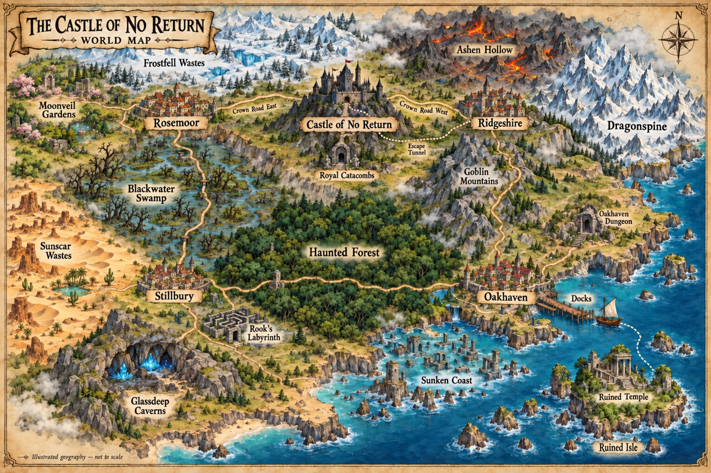

# The Castle of No Return

A roguelike adventure game inspired by *Castle of the Winds* by SaadaSoft. Explore dungeons, battle enemies, and survive the challenge!

**GitHub:** [https://github.com/christsantiris/c_rpg](https://github.com/christsantiris/c_rpg)

## Table of Contents

- [Overview](#overview)
- [World Map](#world-map)
- [Controls](#controls)
- [Game Documentation](#game-documentation)
- [Screenshots](#screenshots)
- [Building and Running](#building-and-running)
- [Dependencies](#dependencies)
- [Contributing](#contributing)
- [License](#license)
- [Installers](#installers)
- [Credits](#credits)
- [Roadmap](#roadmap)

## Overview

*The Castle of No Return* is a C/SDL roguelike adventure with turn-based combat and a
retro pixel-art style. Choose a Warrior, Mage, or Rogue, prepare in town, and
explore a five-floor undead dungeon, the seven-stage haunted forest, goblin mountains 
and many other adventures.

## World Map

[](docs/images/world-map.png)

An illustrated overview based on the world's town connections.

## Controls

At **30% HP or below**, the play area gains a slowly pulsing red border and the
HP display turns red with a **LOW HEALTH** label. Heal above 30% to clear the
warning. Open inventory with **I** to use a Health Potion.

These are the default keys. Choose **Controls** from the title menu or press
`Esc` during a game and choose **Controls**. Select a command, press `Enter`
(or click it), then press
the new key. Picking a key another command uses swaps the two keys. `Esc` and
the arrow keys cannot be changed, so the menu and movement always work, and the
move-left key also interacts. Keys inside views such as the inventory stay the
same. Changes save automatically in `saves/controls.json` and apply across
restarts, new characters, and loaded games. If no hotkey settings exist, loading
an existing character adopts that save's keys. The help screen (`H` by default)
always shows the current keys.

| Key | Action |
| --- | --- |
| `WASD` or arrow keys | Move; `A` interacts when at a contextual object |
| `.` / `,` | Take the onward route / return by stairs or region entrance |
| `P` | Pick up an item or cache on the current tile |
| `T` | Talk to a nearby NPC or rescue a forest warden |
| `I` | Open or close inventory |
| `B` | Open spellbook |
| `Q` | Open the quest and boss journal |
| `C` | Cast the equipped spell |
| `F` | Use an equipped bow or the Demonic Sword's ranged attack |
| `H` | Open help |
| `Esc` | Close the current view or return to the main menu |

Inside the inventory, use the arrow keys to select an item, `U` to use it,
`E` or `Enter` to equip it, `O` to equip a one-handed weapon in the off hand,
`X` to unequip the selected item, and `D` to drop it. Unequipping the main-hand
weapon promotes an off-hand weapon to the main hand; the removed weapon stays
in inventory and can then be equipped with `O` to swap hands. Inventory action
labels also support mouse clicks. In the spellbook, select a spell and press
`E` or `Enter` to equip it. Shops and the docks use the arrow keys and
`Enter`; shop buy and sell modes are switched with `Tab`.

Using an item keeps the inventory open, even after consuming the last item.
Close it manually with **I** (or the remapped inventory key) or **Esc**.
Drinking any potion still consumes one combat turn: enemies respond, and
poison and freezing advance with that turn.
Attempting to drink at full HP or MP keeps the potion and costs no turn;
reading scrolls and equipping, unequipping or dropping items remain free
inventory actions.

## Game Documentation

- [Stillbury healer and witch](docs/healer.md)
- [Regional difficulty and progression](docs/difficulty-scaling.md)
- [Weapons, armor, and shields](docs/weapons.md)
- [Spells](docs/spells.md) and [Mage progression](docs/mage-progression.md)
- [Tavern quests](docs/tavern-quests.md) and [quest journal](docs/quest-journal.md)
- [Castle Dungeon](docs/dungeon.md)
- [Haunted Forest](docs/haunted-forest.md)
- [Goblin Mountains](docs/goblin-mountains.md)
- [Dragonspine and High Pass](docs/dragonspine.md)
- [Sunken Coast](docs/sunken-coast.md)
- [Blackwater Swamp](docs/swamp.md)
- [Sunscar Wastes and the magic lamp quest](docs/sunscar-wastes.md)
- [Moonveil Gardens](docs/moonveil-gardens.md)
- [Ashen Hollow](docs/ashen-hollow.md)
- [Glassdeep Caverns](docs/glassdeep-caverns.md)
- [Royal Catacombs](docs/catacombs.md)
- [Castle interior and play testing](docs/castle-design.md)
- [Docks, Ruined Isle, and Ruined Temple](docs/harbor-and-ruined-isle.md)

## Screenshots

Below are screenshots of the game in action:


## Building and Running

Build a release executable with `make`, or build and start it with `make run`.
The executable is written to `build/conr`.

### Browser play and GitHub Pages

The browser build compiles the same C/SDL2 game to WebAssembly, following the
[Wolfenstein browser build](https://github.com/christsantiris/wolfenstein2026/commit/fc2bd59fc61dcad1221c365d1081a009f196cf4a)
and its [Pages workflow](https://github.com/christsantiris/wolfenstein2026/commit/a25b666f895b49a70bbd55ec4dc5f9b10b89024a),
including the [CI build-command correction](https://github.com/christsantiris/wolfenstein2026/commit/e6c8b711048eb36db69b59265cebcbac00b8322d).
Players need a desktop browser, keyboard and mouse; they do not install the game.
See [browser build and deployment instructions](docs/browser.md) for local
preview, GitHub Pages setup and troubleshooting.

From the project root, use the same installed SDK as Wolfenstein:

```sh
source /private/tmp/wolf-browser-emsdk/emsdk_env.sh
make browser-run
```

Open **http://localhost:8000/**, then select **Play**. Run `source` again in
each new terminal. If the temporary SDK directory is removed, install
Emscripten 4.0.23 in a permanent location and update that path.

Once these changes reach `master`, the **Browser Pages** workflow builds and
deploys `dist/browser/`. In the repository's **Settings → Pages**, first set
**Build and deployment → Source** to **GitHub Actions**. After a successful
deployment, the game will be available at
[Castle of No Return on Pages](https://christsantiris.github.io/c_rpg/).

Save slots, hotkey settings, and high scores persist in this
browser's site storage. Desktop saves are not uploaded or bundled. Clearing
site data removes browser saves; storage restrictions can make them temporary.

### Debug interface

To test quest NPCs with every town shortcut already open, run:

```bash
./tools/debug_shortcuts.sh
```

Select **New Game**, enter a name, and choose a class. The forest shortcut
between Oakhaven and Stillbury, swamp shortcut between Stillbury and Rosemoor,
and High Pass between Oakhaven and Ridgeshire are open immediately. This uses
the existing completion flags for the forest, mountain, and swamp bosses;
quests stay unassigned and their NPCs still award their normal rewards.
The unlocks persist if you save this debug character.

The launcher builds a separate debug executable in `build/debug-shortcuts`
and runs it from the project directory. It accepts the existing debug options,
for example `./tools/debug_shortcuts.sh --gold 500 --weapon bow`.

The `debug` target builds the game with debug support and accepts optional
Make variables for configuring the next new character:

```bash
make debug WEAPON=bow GOLD=500 SCROLLS=magic-arrow,fireball,heal
```

| Make variable | Executable option | Accepted values | Behavior when omitted |
| --- | --- | --- | --- |
| `WEAPON` | `--weapon NAME` | Any [debug weapon name](#debug-weapon-names), or `none` | Keep the selected class's normal starting weapon |
| `GOLD` | `--gold N` | Any whole number from `0` through `999999` | Keep the normal starting gold |
| `SCROLLS` | `--scrolls LIST` | Up to three comma-separated values chosen from `magic-arrow`, `fireball`, and `heal`, or `none` | Keep the selected class's normal starting scrolls |
| Not applicable | `--unlock-shortcuts` | Flag with no value; automatically supplied by `tools/debug_shortcuts.sh` | Town shortcuts unlock through normal boss victories |

Providing `WEAPON` or `SCROLLS` replaces the normal class starting items in
that category. Use `WEAPON=none` or `SCROLLS=none` to begin without that item
category. Scroll names must be comma-separated without spaces. These settings
are applied after class selection when a new game is created; they do not
modify a loaded save.

#### Debug weapon names

Every weapon, including boss rewards, is available for testing. Use these names
with `--weapon` or `WEAPON`. Normal class restrictions still apply; open inventory
with **I** and equip the weapon with **E** or **Enter**.

| Weapon family | Accepted names |
| --- | --- |
| Swords | `rusty-sword`, `short-sword`, `long-sword`, `magic-long-sword`, `demonic-sword`, `greatsword`, `magic-greatsword`, `cryptblade` |
| Axes | `battle-axe`, `magic-battle-axe`, `embercleaver` |
| Staves | `staff`, `runed-staff`, `magic-staff`, `sandstorm-staff` |
| Bows | `hunting-bow` (`bow` also works), `shortbow`, `longbow`, `crossbow`, `magic-longbow`, `krakenbone-bow` |
| Daggers | `rusty-dagger`, `dagger`, `magic-dagger` |

Examples:

```bash
# Start NPC testing with all town shortcuts open.
./tools/debug_shortcuts.sh

# Combine unlocked shortcuts with a custom starting loadout.
./tools/debug_shortcuts.sh --gold 500 --weapon bow --scrolls magic-arrow,fireball,heal

# Start a Warrior test with unlocked shortcuts, 1,000 gold, and a Magic Greatsword.
./tools/debug_shortcuts.sh --gold 1000 --weapon magic-greatsword

# Override every supported starting value.
make debug WEAPON=bow GOLD=500 SCROLLS=magic-arrow,fireball,heal

# Test an empty weapon and scroll loadout while retaining normal starting gold.
make debug WEAPON=none SCROLLS=none

# Override only gold and retain the selected class's normal equipment.
make debug GOLD=10000
```

After building a debug executable, the corresponding command-line options can
also be passed directly:

```bash
./build/conr --weapon bow --gold 500 --scrolls magic-arrow,heal
```

Debug executables also accept `--unlock-shortcuts` for new characters.
As with the loadout options, it does not modify a loaded save.

Unknown options, unsupported item names, lists longer than three scrolls, and
gold values outside the accepted range cause the program to print usage
information and exit before starting the game.

### Clean the build

Run `make clean` to remove the build directory.

### Run the tests

Run `make test` to build and run the unit test executable.

## Dependencies

- CMake 3.20 or newer
- A C99 compiler
- SDL2
- SDL2_ttf
- SDL2_mixer
- pkg-config on Linux

## Contributing

Pull requests that improve the game are welcome.

## License

MIT

## Installers
For MacOS run `chmod +x package/macos/build_dmg.sh` then `make dmg`
and drag the file into applications and double click!

For Linux run `chmod +x package/linux/build_linux.sh` then `make linux`.
Extract `dist/CastleOfNoReturn-linux-x86_64.tar.gz`, then either:
- Run directly: `cd linux && ./run.sh`
- Install as a desktop app: `./install.sh` — adds the game to your app launcher with a double-clickable icon

## Credits
[Pixabay](https://pixabay.com/) for the sound effects

## Roadmap

### Production releases

- Signed Apple DMG
- Windows installer
- Fix Linux installer

### Feature enhancements
- Expand world map
   Farms between areas for rest to improve hp. Additional in-town quests similar to labrynth. New areas. New story lines. 
- Recruit a party to join the adventure
   NPCs that can team up with the player character and accompany on the quest. Implement resurrection. 
- Improve difficulty scaling and economy
   Warrior and Rogue should struggle at certain levels without better weapons. Mage should struggle without better spells. Purchasing new weapons, armor and tomes should become necessary to progress.
- Add paypal integration to buy gold
   Add real money feature to buy in-game gold.
- DnD style stats instead of static class based stats
   Roll for stats. Choose a class based on strengths. Ascending armor class chance to hit. 

