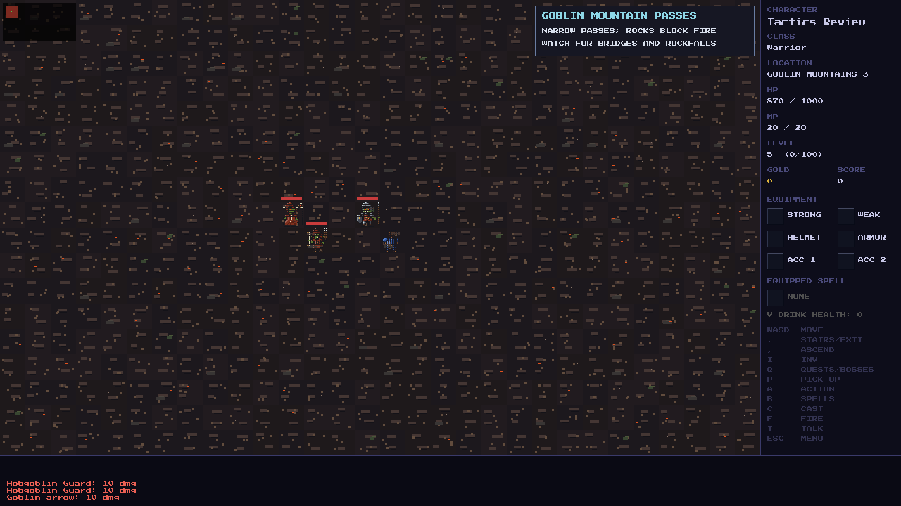
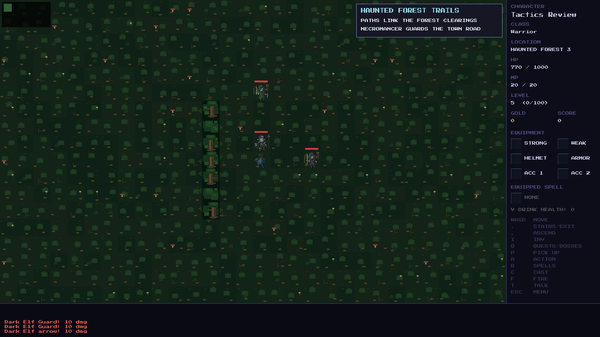

# Forest and mountain combat review

This change covers the Haunted Forest and Goblin Mountains as parallel
post-dungeon adventures. It adds distinct squad tactics and repairs two
companion combat interactions. Existing enemy statistics, roster weights,
stage counts, boss mechanics, quest requirements and geography are retained.

## Balance decision

Keep the fixed outward band introduced in `dbe1c97`: regular enemies receive
10% extra HP, +4 attack, +1 defense and a roster two difficulty steps deeper.
The two regions ignore boss order. Defeating one therefore never makes the
other an unexpectedly harder second choice. Existing modest player-level
scaling still applies when enemies spawn; cached enemies retain their stats.

The early ranger rescues and map fragments remain on stages 1–2, allowing a
return to Oakhaven before the deeper boss hunt. Neither boss requires quest
acceptance or completion. Boss warnings, recovery windows, grave consecration,
powder kegs and retreat remain the tools for those fights.

Representative spawned statistics at player level 5:

| Enemy | HP | Attack | Defense |
| --- | ---: | ---: | ---: |
| Giant Spider | 21 | 12 | 3 |
| Dark Elf Archer | 25 | 14 | 4 |
| Dark Elf Ranger | 44 | 17 | 4 |
| Dark Elf Guard | 41 | 16 | 8 |
| Goblin Archer | 18 | 12 | 2 |
| Goblin Warchief | 46 | 17 | 5 |
| Goblin Shaman | 30 | 15 | 3 |
| Hobgoblin Guard | 41 | 16 | 8 |
| Necromancer | 173 | 19 | 6 |
| Goblin King | 189 | 21 | 8 |

This creates different pressures: forest bow units establish crossfire while
mountain groups protect ranged attackers and healers. Additional numerical
buffs would compound the tactical change without reliable expedition evidence.

## Tactical behavior

- Mountain goblins within six tiles coordinate when several front positions
  are open. Melee units take the shoulders, Archers keep a center firing lane,
  and Shamans hold farther back. A narrow corridor breaks formation.
- Forest Dark Elves within six tiles choose different approach sectors. Guards
  engage while bow units seek reachable, unobstructed firing lanes. Paths go
  around trees and occupied squares; a ranged flank avoids the player's
  immediate melee zone. An unavailable route falls back to normal behavior.
- Existing three-pursuer selection, notice distances, attack cadence, slow
  trolls, fast creatures, poison, projectile cover and boss timing remain.
  These tactics grant no extra movement steps. Rangers retain their existing
  movement opportunity after shooting.
- Lone enemies use their existing behavior. Mountain formations and forest
  flanking are restricted to their respective regions.

Actual SDL renderer captures of controlled encounters, after resolving real
enemy turns. Test actors have extra HP to keep the squad visible; these images
are movement demonstrations, not balance measurements.



The Guard is beside the player, the Archer is three tiles west, and the Shaman
is farther west on the shoulder. The center lane remains clear.



The elves have walked around the tree barrier. The Guard engages from the
north, while the bow units establish northern and eastern firing lanes.

## Companion regressions found

The earlier party integration checked adjacent Aldric before ordinary enemy
roles. That could replace an Archer's scheduled shot or a Shaman's scheduled
heal with melee, without advancing its role timer. Role actions now run before
the fallback attack on Aldric. Enemies still defend themselves against him
when they have no role action to perform.

Enemy projectile paths also ignored Aldric. His occupied tile now blocks those
shots, as other occupied actor tiles do. This is a shared combat fix, so it
also applies to existing ranged enemies outside the two regions.

No persistent fields were added. Squad choices are derived from saved enemy
positions, roles and timers. A save/load test verifies the same next tactical
moves and damage after loading an active encounter.

## Validation and evidence limits

- Native game and test runner build successfully; **6,511/6,511 assertions pass**.
- New checks exercise formations from all four directions, moving targets,
  narrow passes, tree detours, firing lanes, both bow cadences, companion role
  priority, collision and save/load continuation.
- Four seeds at every stage of both regions produce **40 generated encounters**,
  each run for 24 enemy turns. Actors remain on valid tiles without overlap;
  squad members move at most one tile, and terrain, transitions and spawned
  statistics remain intact. Bosses are frozen in this regular-squad stress
  check; the existing Necromancer and Goblin King suites test their encounters.
- The existing guard-protection, terrain, travel, quest-chain, projectile,
  movement, scaling and boss regression suites remain enabled and pass.
- Both tactical demonstrations were inspected in the actual SDL renderer.
- Tactical checks also pass with AddressSanitizer and UndefinedBehaviorSanitizer;
  the new movement module passes `-Wall -Wextra -Werror` syntax checks.

The optional probe can be repeated after building the test runner:

```sh
cmake -S . -B build -G "Unix Makefiles"
cmake --build build --target test_runner --parallel 4
python3 tools/act2_combat_probe.py
```

It runs **720 controlled encounters**, using 20 seeds for each combination of
class, preparation, companion, region and group. Fresh characters use actual
starting equipment and no extra supplies. Prepared characters gain 1,000 XP
through the level-up function (level 5), equip the Crypt Ring, and buy common
gear and supplies through the actual shop/equipment APIs:

| Class | Purchases | Total gold |
| --- | --- | ---: |
| Warrior | Short Sword, Chain Mail, three Health Potions | 300 |
| Mage | Magic Arrow scroll, Apprentice Robes, three Health Potions, two Mana Potions; retains starting staff | 270 |
| Rogue | Hunting Bow, Leather Armor, three Health Potions | 300 |

The probe starts fully rested. It tests three Spider Captors or a Warchief,
Archer and Spider as early groups, plus Guard/Archer/Ranger and
Guard/Archer/Shaman squads. It uses real movement, attacks, spells, potions,
enemy turns, experience and equipment effects. It does not edit enemy health,
teleport during combat, open routes, award remote loot or restore health during
the fight. Each group is an isolated open-ground encounter.

All prepared builds defeated these groups in every tested seed, both solo and
with Aldric. Fresh Mages without a spell and fresh Rogues had substantially
less margin; a fresh Warrior could beat some groups. Early exploration should
allow individual victories, so losing every opening fight is not a target.
These are checks for viable combat tools and preparation, **not complete
expedition win rates or a guarantee of adequate quest income**. Full stage-1/2
quest loops, resupply costs and boss expeditions still need human playtesting.

The earlier scratch autoplay tool bypassed terrain interactions and some
travel, supplied extra fresh-character consumables and kept the Rogue on a
starter dagger in its quoted runs. Its old completion percentages and proposed
blanket Rogue rebalance have been removed from the scaling documentation.

History review also found that `e9f6fe7` removed 26,318 test lines across 63
affected test files, largely for deferred regions. The forest, mountain,
movement, scaling and both boss suites were retained without edits in that
commit. Passing the current suite establishes current coverage, not restored
coverage for the rest of the V1 world.

The later [Soulstone Shrine change](../soulstone-shrine/README.md) replaces
Aldric's Inn recovery with persistent death, paid resurrection and a level-10
Mage ritual. The tactical behavior described here retains its existing rules.
