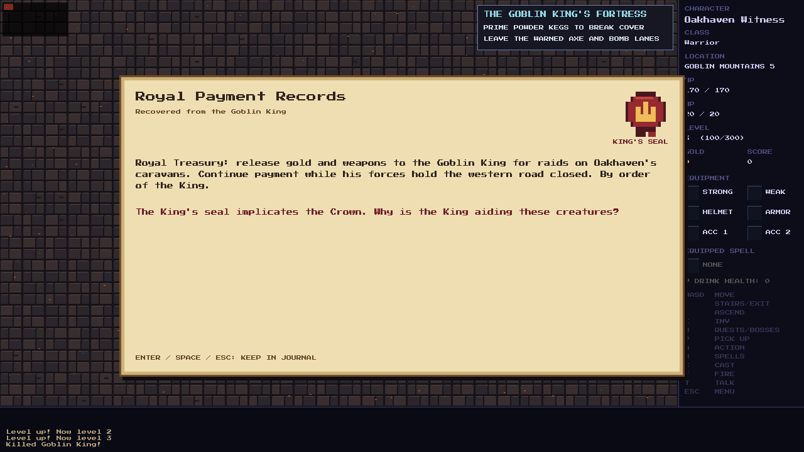
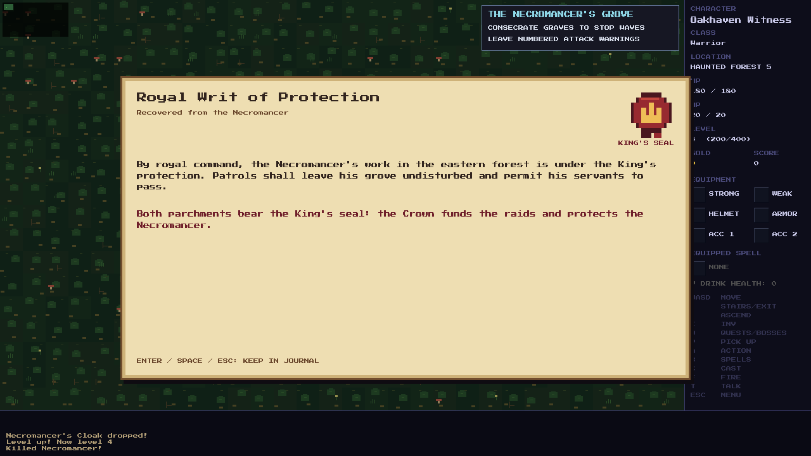
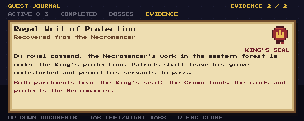

# Act 2 story payoff

The player can hear Elowen implicate the King after her rescue. Both regional
bosses now connect to the Crown without revealing
the Royal Arcanist's involvement or the King's manipulation.

| Boss | Parchment bearing the King's seal | What it establishes |
| --- | --- | --- |
| Goblin King | Royal payment records funding raids and the western-road blockade | The Crown is financing the goblins rather than simply failing to stop them. |
| Necromancer | Correspondence granting royal protection to his work and ordering patrols to leave his grove undisturbed | The Crown is protecting the evil in the forest. |

Each boss's defeat displays its parchment, including a clearly visible King's
seal. Either document deepens the suspicion raised by Elowen; discovering both
corroborates it. The records can be genuine royal documents while leaving the
King's reasons unknown. Neither names, titles or otherwise reveals the Royal
Arcanist as the cause.

The two adventures remain independent and playable in either order. Evidence
must be awarded even without accepting Alder's or Dain's quests. Each boss
opens its own onward road; collecting both documents does not become a new
travel requirement. No extra Inn return is required. Evidence should remain
readable in the journal, consume no bag or active-quest slot, and survive
save/load. Optional later conversations with Alder or Dain can acknowledge
the relevant discovery. Rook's Labyrinth belongs to a later arc.

After the storyline addition, increase enemy health by **5%** throughout
Haunted Forest and Goblin Mountains, including their bosses. Preserve attack
damage, defense, behavior, formation/flanking tactics, warning and recovery
timing, XP and loot. Apply the increase once, with integer rounding, and
preserve existing deaths, boss victories and relative wounds in saved stages.
Noncombat road guards remain outside the combat roster.

The story implementation is complete. The following **5% health increase**
remains authorized for the next separate change set.

## Presentation and persistence

The current attack and enemy-response animations finish before the automatic
parchment appears. Movement, combat and mouse commands are held until Enter,
Space or Esc closes it; held confirmation keys cannot skip a fresh page.
Acknowledgment uses no turn. The opening is independent of class, quests,
inventory capacity, ordinary enemies remaining alive and the other boss.
Boss loot and onward-road unlocks retain their existing behavior.

The journal has an **Evidence** tab after Bosses. Up/Down selects a discovered
document; the page displays its text, a native red wax seal with a gold crown,
and the current conclusion. Finding both changes that conclusion. The closing
hint uses the character's remapped journal key. Existing Active, Completed
and Bosses tabs keep their order and quests retain the three-active limit.

Dain's completed map points toward the fortress stores. Alder's rescued
rangers report couriers reaching the grove. Their boss follow-ups now ask the
player to search the records or correspondence. Completed quest summaries
name the recovered evidence. Optional later NPC dialogue interprets the
relevant document, recognizes both records if found, and gives the same onward
directions without another reward or required trip to Oakhaven.

The documents derive from the existing saved boss victories. Save version
**235** adds `royal_evidence_seen` to preserve which automatic pages were
acknowledged. A current save made before acknowledgment resumes that page;
one made afterward does not repeat it. Older saves receive journal evidence
for prior victories and mark those pages acknowledged, preserving progress
without interrupting the resumed adventure. Debug road unlocks grant no
evidence. No equipment, inventory objects, geography or combat stats change.

## Validation

- Native game build and **6,931/6,931** gameplay assertions pass.
- Both victory orders, no accepted quests, full inventory, living ordinary
  enemies, independent road unlocks, remapped journal hints, held keys,
  acknowledgment, game-over controls, legacy/current saves and invalid saved
  acknowledgment data are covered. Existing boss tests verify discovery after
  melee, bow, Magic Arrow, Fireball and Frost Bolt kills.
- Optional NPC follow-ups are checked for each single clue and both clues,
  correct onward directions, no duplicate payment, and untruncated dialogue.
- New model and parchment renderer pass `-Wall -Wextra -Werror` syntax checks.
- Native SDL review covers each automatic parchment, journal rereading,
  corroboration and both NPC follow-ups, including 1280×720, 640×480 and the
  minimum 600×240 window. The seal, text and navigation remain visible.

