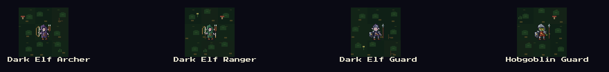
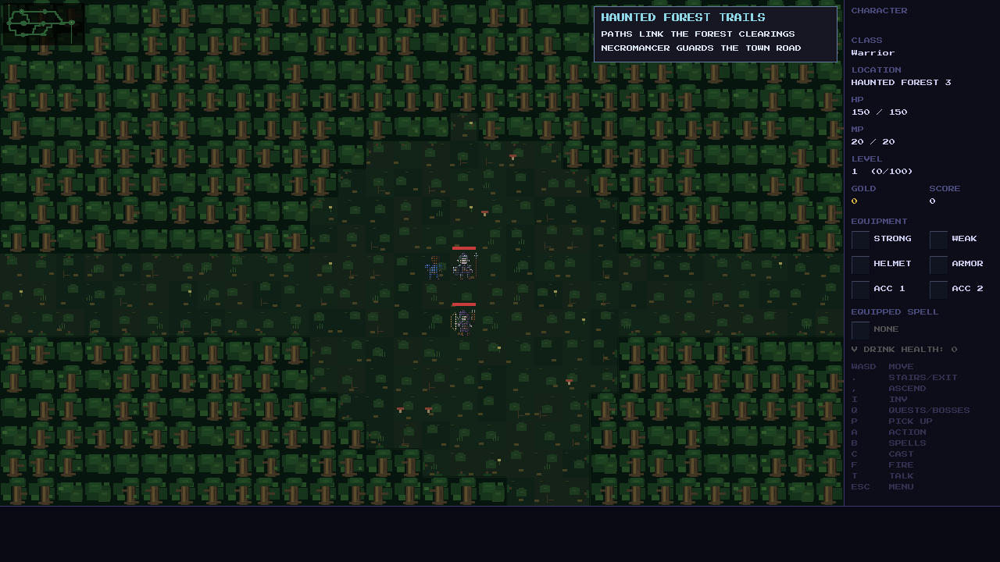

# Dark Elf Guard

The approved Haunted Forest roster adds an armored melee Dark Elf, with the
same base strength as a Hobgoblin Guard: 36 HP, 11 attack, 7 defense and
44 experience. Existing regional scaling applies. The regular roster introduces
Guards in Forest 3 (Dark Elf Territory), then retains them in deeper stages.
Goblin Mountains already matches the approved seven-type regular roster.

The Guard uses the existing native 24×24 C sprite templates in
`src/renderer/forest_enemy_art.h` and the forest palette in
`src/renderer/sprites.c`: lavender skin, purple hood and cloth, steel armor,
shield and spear. The comparison below enlarges actual SDL-rendered sprites
by 2× with nearest-neighbor sampling.

Validation, 2026-11-01:

- Game and test runner build successfully; **9,323/9,323** checks pass.
- All five forest and mountain stages use only the approved regular rosters
  across eight seeds, both before and after the Lich victory.
- Guard protection priority, melee attacks, kill rewards and Necromancer
  resurrection are exercised through gameplay actions.
- Active and cached Guard identity, wounds, poison and freezing survive
  save/load through the existing enemy serialization. No new persistent fields
  or save migrations are needed; the new enemy ID is appended as 125.
- Sprite comparison and normal/frozen Forest 3 captures use the actual game
  renderer. Native scale, terrain transparency, armor, weapons and frozen
  overlay are visually reviewed.
