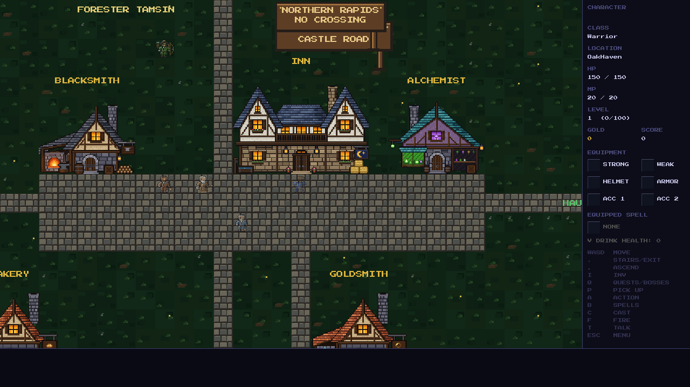
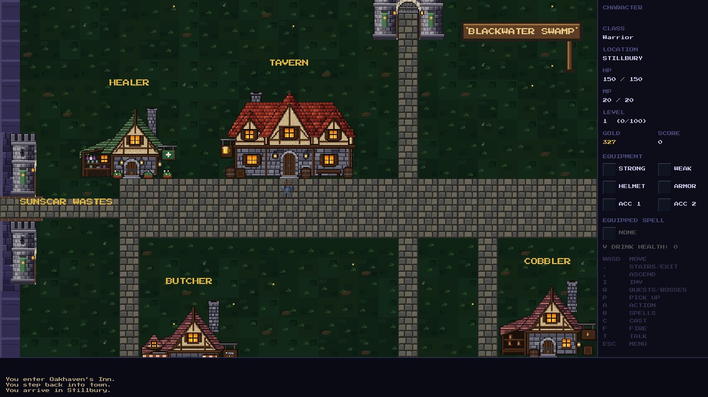

# Oakhaven Inn and Stillbury Tavern

The first Chapter 1 story-preparation step swaps the two buildings' names and
existing exterior artwork. Oakhaven uses the established `inn.bmp`; Stillbury
uses `tavern.bmp`. Both are native pixelkit buildings with the same 7×5-tile
footprint and centered doorway, so the town lots and working entrances stay
in place. No new building artwork is generated.

Town labels, interior location labels, game-over locations, entry messages,
NPC directions and quest-journal return instructions use the new names.
The historical location identifiers remain stable for save/load. NPC role
changes and the new rescue story are later steps.

Validation, 2026-11-01:

- Game and test runner build successfully; **9,323/9,323** checks pass.
- Existing pixelkit sprites are inspected at native scale and beside the
  existing neighboring buildings in the actual game renderer.
- Both exteriors and interiors render the correct new building labels.
- Real movement enters each door and leaves through the interior exit,
  returning to the corresponding town and walkable street tile.
- Saving and loading inside both buildings preserves the interior, gold and
  Cain's scroll state, followed by a successful physical return to town.
- No new persistent fields, changed serialized IDs or save migrations are needed.
