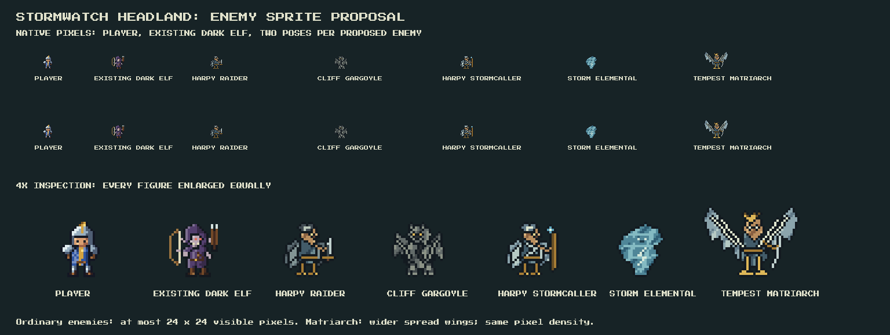

# Stormwatch native art and renderer checks

Native assets for [Stormwatch Headland](../../stormwatch-headland.md), generated with the established pixelkit pipeline.

The comparison was rendered in SDL beside the game's actual player and Dark
Elf. Its upper rows are native pixels; every figure in the lower row is
enlarged equally by four. Both poses have transparent backgrounds and the same
ground line. No existing game actor is rescaled.

| Creature | Visible bounds, pose 1 | Visible bounds, pose 2 |
| --- | --- | --- |
| Harpy Raider | 23×24 | 23×24 |
| Cliff Gargoyle | 23×24 | 23×24 |
| Harpy Stormcaller | 23×24 | 23×24 |
| Storm Elemental | 21×24 | 21×24 |
| Tempest Matriarch | 42×31 | 42×33 |

Regenerate with `python3 tools/sprites/stormwatch.py`. The existing pixelkit
pipeline produces [enemies.bmp](enemies.bmp) and [enemies.png](enemies.png): five
48×48 padded cells per row, two pose rows. Ordinary bodies occupy at most
24×24 visible pixels. The Matriarch's wider frame accommodates spread wings.
The generator checks these bounds and the shared foot line for each pose.

Runtime assets are `assets/images/stormwatch-enemies.bmp` and
`assets/images/stormwatch-entrance.bmp`. The 168×144 watchfort has a human-sized
arched doorway and transparent ground. Its masonry uses pixelkit's `flat_wall`.

Actual SDL game captures:

- [Native scale beside the blacksmith and player](stormwatch-native.png).
- [Roadside entrance](stormwatch-approach.png) and [Dawnmere east gate](stormwatch-dawnmere.png).
- [Stage 1](stormwatch-stage1.png), [stage 2](stormwatch-stage2.png),
  [stage 3](stormwatch-stage3.png), [stage 4](stormwatch-stage4.png), [stage 5](stormwatch-stage5.png).
- [Atlas edit and protected coastal geography](atlas-edit.md), with the [exact prompt](atlas-prompt.txt).

The generator asserts both poses' visible bounds and foot alignment; the SDL
integration test draws every new enemy inside the actual adventure renderer.

Wind feedback captures from the actual SDL renderer:

- [Two-second warning](stormwatch-wind-warning2.png).
- [One-second warning and contextual brace prompt](stormwatch-wind-warning1.png).
- [Start of the gust displacement](stormwatch-wind-push-start.png).
- [Player at the destination tile](stormwatch-wind-push-end.png).

Keyboard regression checks exercise the application's left-key handler and
normal player/enemy action sequence on generated terrain. They verify deliberate
bracing, arrow movement, actual tile displacement and animation completion.
Idle-frame checks run the same environmental clock as the main application,
including a real SDL clock run without key events. Menu pauses and exact partial
seconds are covered; idle wind gives enemies no additional turns.
