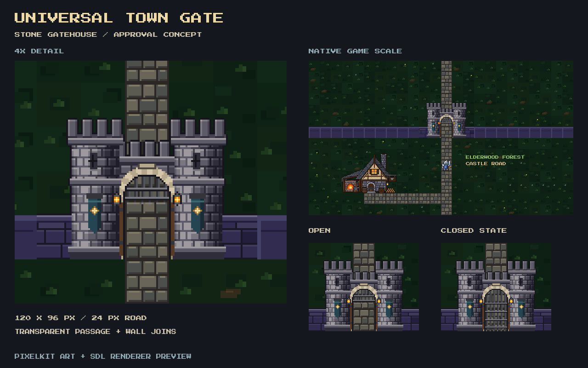

# Universal town gate proposal

**Status: approved.** This folder retains the original design review. The
implemented directional family and current game captures are documented in
[town-gates](../town-gates/README.md).

The shared design is a compact medieval stone gatehouse: two crenellated
towers, arrow slits, a pale stone arch, iron-reinforced oak door leaves folded
against the jambs, a raised portcullis, and warm lanterns. Muted teal pennants
can take each town's colors. Destination names stay on the existing signs.
Low slate-purple wing walls connect to the present town walls.

The sprite is **120 × 96 native pixels**, with a **24-pixel single-tile opening**
centered at x=60. The opening has real alpha transparency: the underlying road
continues through it. There is no painted floor, black portal rectangle, or
background tile in the sprite. The open portcullis leaves the lower passage
clear; the closed frame illustrates the same architecture for exits that are
already locked by game rules.

The approved family uses this architecture for all ordinary town gates,
including Oakhaven's Elderwood exit. North, south, east, and west views use
upright towers and consistent lighting. Town-side views expose the gate's
winch and timber bracing. Area entrance landmarks retain their own regional
architecture.

## Art and scale review

[generate.py](generate.py) uses the established
[pixelkit.py](../../../tools/sprites/pixelkit.py) masonry, cylindrical shading,
crenellation, outlining, and lantern helpers. Its material and detail sizes
match the existing local buildings. It writes only to this proposal folder.

[preview.c](preview.c) renders the proposal through the game's actual SDL
renderer, alongside the unchanged town grass, single-tile road, wall,
blacksmith, and equipped Warrior. It uses the real `draw_town_floor`,
`draw_town_path`, `draw_wall`, `draw_shop_blacksmith`, and `draw_player_at`
functions, with the proposal texture drawn one native pixel per screen pixel.
This is a staged art-review scene, not a changed gameplay map.

- [Open native sprite](gate-open.png)
- [Closed native sprite](gate-closed.png)
- [Native SDL scene with player and blacksmith](open-scene.png)
- [Closed SDL scene](closed-scene.png)
- [Historical mountain gate in the same scene](previous-scene.png)

The review sheet uses nearest-neighbor enlargement; the underlying sprites
remain at native scale. Generate with
`.venv/bin/python docs/art-sources/town-gate-proposal/generate.py`; run the
preview harness linked with the project's renderer objects to capture
`/tmp/town-gate-{open,closed}-scene.bmp`, convert those captures to
the PNGs above, then run `compose.py` to refresh the sheet. The harness does
not create a GameState or read or write player saves. The historical mountain
gate capture is retained from the original review.
