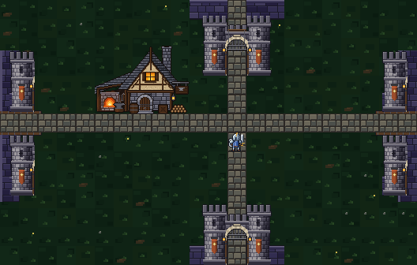

# Universal town gates — native art and renderer review

The [approved stone gatehouse](../town-gate-proposal/proposal.png) is used for
all five towns, Castle Grounds, and the castle's Ashen Hollow approach gate.
It replaces the destination-shaped town gates, including Oakhaven's former
mountain-style Elderwood gate. Regional entrance landmarks keep their own art.

The runtime asset is [town-gates.bmp](../../../assets/images/town-gates.bmp),
generated by [town_gate.py](../../../tools/sprites/town_gate.py) with the
established [pixelkit.py](../../../tools/sprites/pixelkit.py) pipeline. The
768 × 1152 transparent atlas contains four upright views in 192 × 192 slots,
with one row per town and one crimson row for Castle Grounds. Empty padding
is transparent; it does not enlarge the buildings. The frontal gatehouse
remains 120 × 96 native pixels, with the approved stonework, pale arch,
arrow slits, lanterns, and raised portcullis. Side views reuse its native
towers above and below the road without rotating them or changing their scale.
The northern town-side view adds its lifting spindle and timber supports.

| Town | Banner color |
| --- | --- |
| Oakhaven | Rust orange |
| Stillbury | Woodland green |
| Rosemoor | Rose |
| Ridgeshire | Slate blue |
| Dawnmere | Ochre gold |
| Castle Grounds | Crimson |

Every opening leaves the full 24-pixel road tile transparent. Low wing walls
join the existing walls. Gates anchor to the actual route's exit tile,
with direction-specific offsets that keep the art inside each town's map.
Destination signs sit beside northern and southern gates, clear of the arches.
The old castle south-gate posts have been removed. Tamsin's name is shifted
left to keep it clear of Oakhaven's northern tower; her position is unchanged.

## Native and game renderer review

Reviewed in the actual SDL game renderer at 1280 × 720. The comparison above
uses one screen pixel per sprite pixel, cropped without resizing. Full town
captures use the game's normal town viewport, which scales all buildings,
gates, ground tiles, and characters together.

| View | Capture |
| --- | --- |
| Oakhaven — Elderwood, forest, dungeon and coast gates | [Oakhaven](oakhaven.png) |
| Stillbury — swamp, forest, desert and quarry gates | [Stillbury](stillbury.png) |
| Rosemoor — frost, giants, swamp and Crown Road gates | [Rosemoor](rosemoor.png) |
| Ridgeshire — Dragonspine, mountains, mines and Crown Road gates | [Ridgeshire](ridgeshire.png) |
| Dawnmere — mountains, dungeon, marsh and Stormwatch gates | [Dawnmere](dawnmere.png) |
| Castle Grounds — Ashen Hollow and all three Crown Roads | [Castle Grounds](castle.png) |
| Castle-side Ashen Hollow approach | [Ashen approach](castle-approach-13.png) |
| Northern road and catacombs entrance retain their existing landmarks | [Catacombs approach](castle-approach-14.png) |

`test_town_gate_renderer` in
[debug_shortcuts_test.c](../../../tools/tests/debug_shortcuts_test.c) checks
all 24 town/direction combinations for visible artwork and a full transparent
road tile, then renders every town and both castle approaches. The town
terrain is compared before and after rendering. The existing harness also
checks normal and debug travel, locked passages, dock access, and save round
trips in an isolated temporary directory.

Generate the atlas with `.venv/bin/python tools/sprites/town_gate.py` or
`make sprites`. Build and run `build/debug-shortcuts/debug_shortcuts_test`
from the project root to reproduce `/tmp/town-gates-*.bmp` captures.

## Compatibility

This change affects renderer resources and drawing only. Exit coordinates,
road widths, collision, quest gates, unlock conditions, regional entrances,
world-map artwork, and town-entry behavior are preserved. Town gates remain
exits, and walking into exterior town sprites still enters town. The closed
frame in the original proposal remains a design reference; this change does
not introduce new locks. No persistent game state or save migration is needed.
