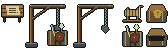

# Break the War Machine — native art and renderer review

Reviewed on 2026-10-27 in the actual SDL game renderer at 1280 × 720, using
its normal viewport and native 24-pixel tile scale.

The runtime atlas is
[war-machine-props.bmp](../../../assets/images/war-machine-props.bmp), generated
by [war_machine.py](../../../tools/sprites/war_machine.py) with the established
[pixelkit.py](../../../tools/sprites/pixelkit.py) pipeline and Ironfang's existing
wood, stone and outline palettes. The desk, winch, weapons crate and coffer are
24 × 24; the loading gantry is 48 × 48. The 168 × 48 atlas has transparent
backgrounds, and every frame is drawn at its native size. Suspended cargo
contains swords, spearheads and a shield. An empty gantry and opened coffer
record completed discoveries visually.

Captures come from `test_war_machine_renderer` in
[debug_shortcuts_test.c](../../../tools/tests/debug_shortcuts_test.c). They were
inspected alongside the existing player, Goblins, minecart, ordinary salvage
cache, bunks, mine rails and Town Hall furnishings at the same rendering scale.
No building or enemy art changes are included.

| View | Capture |
| --- | --- |
| Existing Watchfires offer with independent topic choices | [Veyra's topics](veyra-topics.png) |
| Complete Ironfang quest offer and Y/N acceptance | [Ironfang offer](veyra-offer.png) |
| Shipment desk in the northwest side office | [Shipment office](shipment-office.png) |
| Loaded gantry, working winch, cart and separate salvage cache | [Supply platform](weapons-platform.png) |
| Weapons falling over the flooded shaft | [Falling weapons](falling-weapons.png) |
| Splash at the end of the cosmetic drop | [Splash](weapons-splash.png) |
| Spent stockpile with the return rail intact | [Empty gantry](empty-gantry.png) |
| Command coffer in the Mine Boss's gallery | [Command coffer](command-coffer.png) |
| Three completed objectives and the approved bounty | [Quest journal](journal.png) |

The drop uses a transient combat-feedback event outside persistent game state.
It advances only cosmetic frames and never resolves another enemy turn. Quest
flags preserve the empty stockpile through saves and fresh expeditions.

Reproduce the art with `.venv/bin/python tools/sprites/war_machine.py`. Build and
run `build/debug-shortcuts/debug_shortcuts_test` from the project root to
regenerate `/tmp/war-machine-*.bmp`. The harness keeps saves in an isolated
temporary directory. Quest, cart-route, reward and save compatibility checks
are in [test_war_machine.c](../../../tests/test_war_machine.c).
