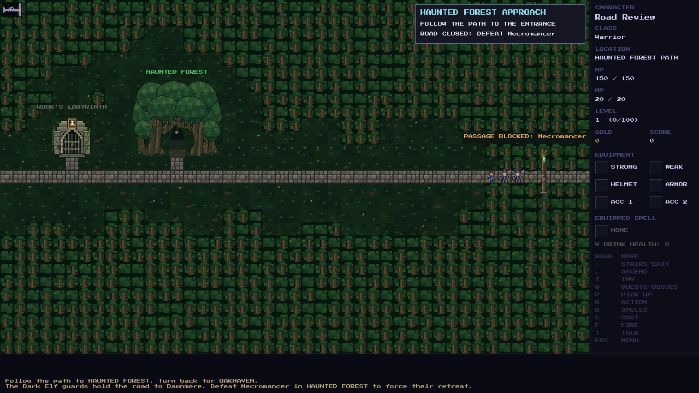
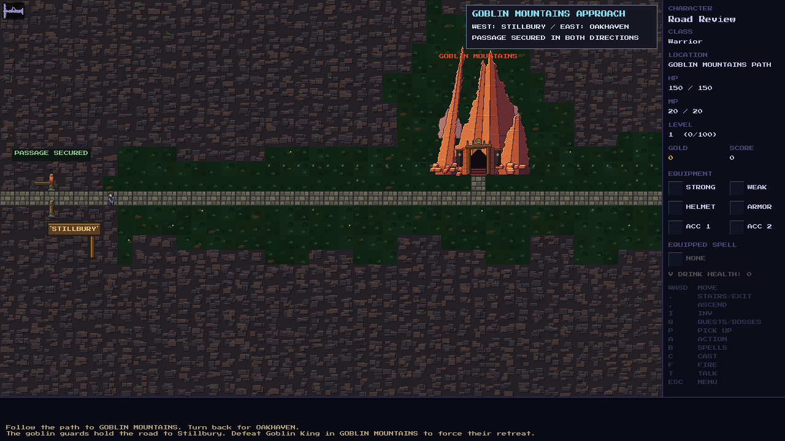
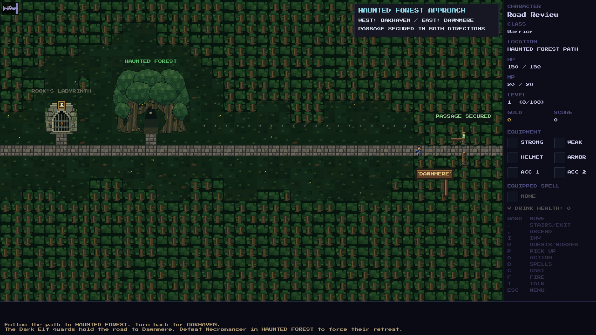

# Boss gates and regional travel

Travel policy is declared in [`rules`](../src/game/boss_gates.c), independently
of quest acceptance. Road access checks use the same saved boss victory from
both approaches. A player can enter an adventure from either side and retreat
to the same side. Defeating its boss permanently secures the passage in both
directions; ordinary enemy respawns never close it again.

| Area | Policy | Requirement or purpose |
| --- | --- | --- |
| Oakhaven Dungeon | Local adventure | Lich King; returns north to Oakhaven |
| Haunted Forest | Boss-gated road | Necromancer; Oakhaven ↔ Dawnmere |
| Goblin Mountains | Boss-gated road | Goblin King; Oakhaven ↔ Stillbury |
| Blackwater Swamp | Boss-gated road | Swamp Demon; Stillbury ↔ Rosemoor |
| Elderwood Forest | Boss-gated road | Elderthorn; Elderwood section of the northern castle connection |
| Royal Catacombs | Boss-gated road | Grave Marshal; Catacombs section of the northern castle connection |
| Sunken Coast | Boss-gated destination | Drowned Queen unlocks the docks; existing chart and sailing rules remain |
| Castle interior | Internal progression | Existing Castellan, Royal Arcanist and Lord Veyr encounter rules |
| Rook's Labyrinth | Deferred | No world entrance in V2; maze and quest implementation retained for a later arc |
| Stonewake Quarry | Free travel | Quarry Colossus and quarry quest remain optional |
| Saltwind Marsh | Free travel | Sszareth does not seal the final departure |
| Stormwatch Headland | Free travel | Tempest Matriarch does not seal the final departure |
| Ironfang Mines | Free travel | Goblin Mine Boss does not seal the final departure |
| Giant's Peaks | Free travel | The Last Jarl still guards the royal vault and crown |
| Sunscar Wastes | Free travel | Desert Pharaoh remains an optional boss |
| Frostfell Wastes | Free travel | Frost Kraken remains an optional boss |
| Dragonspine | Free travel | Red Dragon remains an optional boss |
| Ashen Hollow | Free travel | Cinder Lord remains an optional boss |
| Ruined Temple | Free travel | Existing alignment puzzles and Guardian-protected treasure remain |
| Ruined Isle | Free travel | Landing and temple approach |
| Crown Road East | Free travel | Ordinary encounters do not lock travel |
| Crown Road West | Free travel | Ordinary encounters do not lock travel |
| Crown Road North | Free travel | No additional boss requirement; regional checkpoints control the approach |
| Castle Grounds | Free travel | Exterior connections retain their normal behavior |

## Checkpoints

Compact posts and a lowered beam identify closed road connections. The beam
stays raised after victory. Regional textures distinguish crypt masonry,
woodland checkpoints, goblin timber and the swamp causeway. Banks frame the
crossings and prevent walking around a closed gate. Every gated road draws its
banks as the woods, bog or rock that the road passes through.

Nearby labels name the boss controlling a closed road. Bumping the beam or
using the configured Interact key explains the boss and area requirement.
The approach panel reports passage status. Discovered connections on the
minimap use a lock before victory and a check mark afterward. Entrance sprites
remain available to challenge the boss. Single-tile roads stay single tile.

On Oakhaven's mountain road, two **Hobgoblin Guards** hold the route to
Stillbury. Two **Dark Elf Guards** hold its forest road to Dawnmere. These
noncombat sentries stand in single file, two and three tiles in front of the
beam on the player's approach. They cannot be attacked, frozen or killed, have
no combat health bars, and award no loot or XP. They block walking, projectiles
and Teleport. Bumping a sentry or using Interact explains which boss must fall.
The adventure entrance and retreat to Oakhaven remain available.

Defeating the Goblin King removes the goblin sentries; defeating the Necromancer
removes the Dark Elves. The other boss's defeat has no effect. The normal gate
then opens, and the saved victory keeps its guards absent on return or reload.
The existing debug passage override also hides the guards. No new guards are
added to the opposite towns' approaches.

From Oakhaven, the northern connection encounters Elderwood before Catacombs.
From Castle Grounds, it encounters Catacombs before Elderwood. Each checkpoint
uses its own victory; both are needed to complete the entire journey.
Retreat from a castle-side Catacombs attempt returns north of its closed gate.

## Saves and debug play

Save version **211** appends checkpoint and bank tile IDs, keeping all previous
IDs stable. The policy itself is static; existing serialized boss victories
remain authoritative. Older safe approach maps acquire checkpoints while
retaining exploration, loot, money, quests and all combat caches. A player
stranded beyond a new closed checkpoint is placed on the original approach's
accessible landing. Loot covered by a new bank is moved onto accessible paving,
without covering the town transition.

Guard tile IDs are appended without changing existing IDs. Normal map
serialization and the existing refresh on every load restore them from saved
boss victories; no extra persistent fields are introduced. Older approach
saves acquire sentries in place. A player standing on or behind a new sentry
moves just in front of the group, companions follow onto free ground, and
affected dropped loot moves onto reachable road. Wounds, exploration, gold,
quests and combat-area caches remain intact.

Gated roads cut through scenery and narrow to a single-tile verge at their
checkpoint. See [road scenery](road-scenery.md), including how older saves on
these roads are rebuilt.

`--unlock-shortcuts`, including `tools/debug_shortcuts.sh`, bypasses these
checkpoints without granting boss victories or quest completion. Use a normal
launch with the saved debug override disabled to test closed gates.

The one-way Return to Town spell, castle escape exception, Rowan dialogue,
quest doors, local puzzles and reward eligibility retain their existing rules.

## Verification

`tests/test_boss_gates.c` searches actual walkable terrain and exercises both
approaches, all four northern victory combinations, physical crossings, retreat,
debug overrides, explanations, and save migrations. Existing regional tests
cover free departures before optional bosses die and retain combat/reward checks.
`tools/tests/debug_shortcuts_test.c` captures closed/open checkpoints using the
actual SDL game renderer beside existing landmarks and the player.

Art source: [`road_checkpoints.py`](../tools/sprites/road_checkpoints.py), using
[`pixelkit.py`](../tools/sprites/pixelkit.py) at native 24px tile scale.

The guards reuse the existing native Hobgoblin Guard and Dark Elf Guard art.
Guard verification covers four seeds per road, actual travel to the sentries,
retreat, adventure entry and onward travel, blocked attacks and Teleport,
independent boss unlocks, debug toggles, older map restoration and current save
round trips. The native suite passes **6,723/6,723** assertions. SDL visual review
checks both factions with closed/open gates and at 1280×720 and 640×480.

