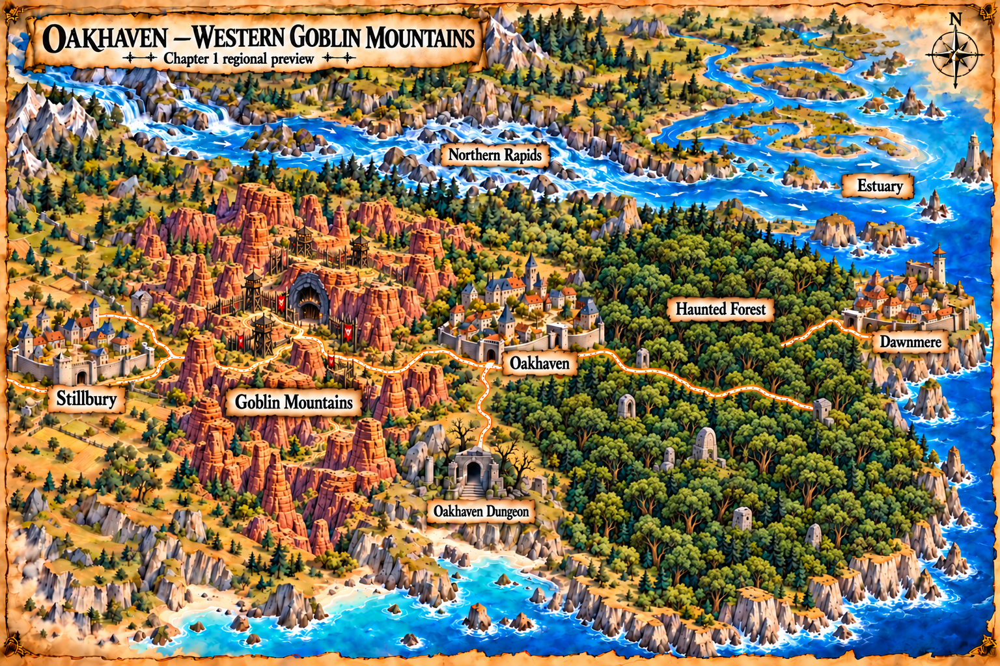

# Chapter 1 V2: Oakhaven

Updated design for review, 2026-11-01. This records the user's Chapter 1
approved decisions and the remaining implementation steps. It supersedes
earlier opening-act proposals where they conflict. Part A changes the playable
geography, forest appearance, README's main world map, and regional preview;
the story and enemy changes follow separately.

The current V2 focus is **Oakhaven, Haunted Forest, Goblin Mountains, and
Oakhaven's dungeon**. Most of the wider world will change. Other regions on
the atlas are provisional context, not an approved V2 layout; their redesign
and later connections belong to separate steps.

## Approved opening

The player arrives in Oakhaven after hearing rumors of evil creatures nearby.
Conversations guide the adventure but are not prerequisites for entering the
dungeon, fighting the Lich King, or freeing Elowen.

- **Bram** is Oakhaven's Innkeeper and Elowen's father. Merge the former
  Oakhaven adviser/Stillbury innkeeper roles into this one character. Retire
  Stillbury's Bram and references to that version of him.
- **Cain** offers the one-time Return to Town scroll. The spell remains a
  one-way escape, with no portal back into the dungeon.
- **Veteran Aldric** explains the danger and can identify the Lich King.
  His advice changes after the victory and avoids lists of specific areas.
- **Elowen** begins as a prisoner, not an available town quest-giver.

Bram, Cain, and Aldric are the starting story cast. Merchants still provide
their services; other story NPCs arrive later. The building-name and exterior
artwork swap is implemented: Oakhaven has the **Inn**, and Stillbury has the
**Tavern**. The existing doors retain their working entrance and return routes.
Bram now stands at Oakhaven's Inn counter in his innkeeper appearance and gives
the Lich King warning there. His town-square version, Stillbury duplicate, and
**Bring Mira Home** quest and swamp encounter are retired. **Save Elowen** now
replaces The Broken Seals: Bram offers the rescue, the Lich's defeat frees her
with or without that offer, and she follows safely until their reunion. Bram
pays 80 gold once; Elowen then stays at the Inn and provides the King clue.
Rook, Mara and Ilya have left the Inn and Tamsin has left the square; their
quests keep any progress until a later act places them again. Alder and Dain's
post-Lich arrivals and short regional quest chains are now implemented.
The [adventure-chain review](../art-sources/oakhaven-adventure-chains/README.md)
records the arrivals, two-stage objectives, optional boss hunts, journal and route checks.
The [Save Elowen review](../art-sources/save-elowen/README.md) records the rescue,
escort, reunion, journal and renderer checks.
The [Bram review](../art-sources/bram-inn/README.md) records the current placement,
retired Mira content, renderer inspection, travel and save/load validation.
The [building swap review](../art-sources/inn-tavern-swap/README.md) records the
renderer inspection, door travel, save/load checks and passing test suite.

The Blacksmith and Alchemist use the established building interaction:
walk through the door, approach the resident, and Talk to open the shop. This is
implemented for Oakhaven: **Blacksmith Joran** and **Alchemist Wren** (placeholder
names) keep their existing exteriors, and their interiors work like the
Goldsmith's, with the stock unchanged. Stillbury's and Rosemoor's shops still
open when the player steps onto their doors.

## Dungeon, rescue, and homecoming

1. Bram can assign **Save Elowen**, explaining that the Lich King holds his
   daughter in the dungeon south of Oakhaven.
2. The player can explore the dungeon without accepting this assignment.
3. Defeating the Lich King frees Elowen in either case. If the player has not
   met Bram, she explains that her father is Oakhaven's Innkeeper and will
   reward her rescue.
4. The rescue objectives are now complete. Record the quest in **Completed**,
   with the reunion/reward instructions retained. It uses no active quest slot.
5. Elowen follows until the player speaks to Bram again. She cannot be attacked
   or killed, does not fight, and accompanies map transitions and Return to Town.
   Physical retreat must also provide a working route home.
6. The reunion pays Bram's reward once. Elowen stops following and becomes a
   permanent resident of the Inn.
7. Elowen thanks the player and says she overheard the Lich King claiming to be
   in league with the king. This gives the first clue against the crown.
   She does not reveal Malakar's involvement.

The old Broken Seals assignment and Stillbury's Bram/Mira rescue are retired.
The rescue, homecoming and all-class Lich reward are implemented. This is a V2
rewrite using fresh saves; the user explicitly waived save migrations.

The Lich now drops **Crypt Ring**, an all-class ring granting **+5 maximum HP
and +5 maximum MP** without an attack or defense bonus. It replaces Cryptblade,
uses either accessory slot, follows the normal two-ring allowance and retains
one-time reward recovery through the reliquary. Bram separately pays **80 gold**
for the rescue. See the [Crypt Ring review](../art-sources/crypt-ring/README.md).

The dungeon is a local southern adventure. It no longer supplies the through
road to Dawnmere. Revisit and retreat remain available after victory, using the northward
path back to Oakhaven.

## Oakhaven's new geography

| Direction | Role | Status |
| --- | --- | --- |
| North | An impassable river with rapids; the player must find a crossing elsewhere in the wider world. | Approved. |
| South | Oakhaven's Lich King dungeon, revisitable after completion. | Approved; the path returns north to Oakhaven, with no through-road. |
| West | Goblin Mountains, then Stillbury. Dain offers his two-half map quest from Oakhaven's Inn. | Selected. |
| East | Haunted Forest, then Dawnmere. Alder offers his two-ranger quest from Oakhaven's Inn. | Selected. |

The two outward choices after the opening are west and east. The southern
dungeon remains a completed local destination; the northern river remains a
geographic barrier. It does not become crossable simply because the Lich dies.

### Selected regional map

The [main world map in README](../../README.md#world-map) incorporates this
layout across the full atlas. The image below is a closer regional view.

**Stillbury → Goblin Mountains → Oakhaven → Haunted Forest → Dawnmere**

The northern river flows east from the highlands, through impassable rapids,
into the estuary and the sea. Oakhaven and both outward roads sit on its south
bank. The estuary is reserved for **Act 3**, potentially Sunken Coast or
Saltwind Marsh; neither destination is selected yet. Do not add a crossing,
provisional Dawnmere junction, or relocated Coast entrance in Part A. Later
connections are explicitly deferred to a separate step.

The dungeon is south of Oakhaven and returns to the same town after victory.
The former Oakhaven–Dungeon–Dawnmere road and Dawnmere–Mountains–Ridgeshire
road are retired. Oakhaven has no northern gate into Elderwood or the castle
road. The existing castle-side northern adventures retain their castle retreat,
with rapids at the southern end rather than a crossing to Oakhaven. Sunken
Coast has no normal V2 entrance until its later connection is designed.

Both outward adventures remain physically accessible before the Lich dies.
Each starts at stage one from either town, allows retreat, and unlocks its
onward town road through its own boss victory. Rook's labyrinth remains on
the Haunted Forest approach, now between Oakhaven and Dawnmere; its gate stays
sealed until Rook returns in a later act.

Restore Haunted Forest's dense green crowns, brown trunks, mossy floor, and
shaded understory, matching the supplied earlier gameplay screenshot. Avoid
skeletal trees and the later nearly black floor. The entrance artwork uses
the existing pixelkit pipeline at its established scale. Elderwood keeps its
own living-forest palette.

The preview was edited with built-in image generation; the exact
[prompt](previews/oakhaven-approved-green-forest-v2.prompt.md) is retained.
Earlier [coast](previews/oakhaven-sunken-coast-v2.png) and
[dark-forest mountain](previews/oakhaven-western-goblin-mountains-v2.png)
comparisons remain archived for reference, rather than active proposals.

### Part B: approved enemy rosters

The approved regular Haunted Forest roster is Pixie, Blighted Wolf, Giant
Spider, Dark Elf Archer, Dark Elf Ranger, Forest Troll and **Dark Elf Guard**.
The new Guard is implemented as an armored melee protector with Hobgoblin
Guard base stats: 36 HP, 11 attack, 7 defense and 44 experience. Guards enter
the normal roster in Dark Elf Territory and the deeper forest stages.

The approved regular Goblin Mountains roster is Goblin Scout, Goblin Archer,
Giant Spider, Goblin Warchief, Goblin Shaman, Cave Troll and Hobgoblin Guard;
the existing roster already matches. The Necromancer and Goblin King remain
the respective bosses. See [the roster reference](../enemy-roster.md).
The [Guard's sprite review and validation](../art-sources/dark-elf-guard/README.md)
record the implemented behavior and passing checks.

This roster change is separate from Part A. Balancing both regions as
alternative post-dungeon adventures remains a separate step; the approved
rosters do not imply that the proposed readiness curve is implemented.

### Exploration before the Lich

The user favors allowing early attempts while tuning the outward adventures
above an ordinary Act 1 character's ability to finish. The recommendation is
to retain physical access, understandable danger, and a practical retreat:

- Entrance sections allow scouting and some isolated fights. Deeper defenders,
  resource demands, and the regional boss make a complete early expedition
  highly unlikely with starter gear. Avoid an unavoidable lethal first step.
- NPC advice explains the danger in ordinary language. Visible encounters and
  attack warnings reinforce it; the game does not require the warning dialogue.
- Normal post-Lich preparation, the all-class reward, and optional Aldric support
  make either outward route viable. Balance every class solo as well, so
  declining Aldric remains a valid choice.
- Early discoveries and victories persist and receive appropriate later credit.
  Meeting the delayed quest-giver must not erase explored maps or demand a
  second copy of a defeated boss.
- Both outward adventures occupy the same intended difficulty band. Choosing
  one first should not cause a large increase in the remaining route's stats.

Pros: the world feels open; scouting has value; listening to advice saves time
and supplies; skilled play can produce an earned exception. Risks: a new
player can mistake retreat for failure, waste supplies, or grind the outward
areas instead of returning to the opening story. Clear warnings, modest early
gains, and a generous escape route help without removing agency.

Difficulty cannot guarantee that nobody wins early: grinding, preparation,
and exceptional play may overcome it. Enforcing absolute failure would require
a gate or an effectively unbeatable encounter. Recommend targeting a normal
starter character's readiness while allowing exceptional victories.

The current implementation counts other original regional boss victories and
increases newly spawned enemy stats after the Lich dies. Its first order tier
adds 45% regular HP and 7 attack. That works against this intended readiness
curve: it can make the outward region easier before completing Act 1. Introduce
explicit regional difficulty bands for the chosen routes, then compare starter,
post-Lich solo, and post-Lich-with-Aldric runs. Do not implement a special
invulnerability or damage switch tied to the Lich flag.

## The next leads and first recruit

On the first return to Oakhaven after defeating the Lich, **Alder and Dain**
appear in the Inn. Alder introduces Haunted Forest to the **east**; Dain
introduces Goblin Mountains to the **west**. Their arrival gating and relocation
are implemented independently of Elowen's reunion or speaking to Bram first.

Alder's **The Lost Rangers** now frees two spider-held rangers on **Forest 1
and 2**. Dain's **Recover the Treasure Map** now finds two halves on **Mountains
1 and 2**. Return to the Inn for their existing one-time rewards, then choose
their follow-ups: **Defeat the Necromancer** and **Defeat the Goblin King**.
These hunts explain the onward journey to Dawnmere or Stillbury to discover
why evil creatures descended on the kingdom. They obey the three active quest
limit, preserve completed first parts, and finish on boss victory without
another Inn return. Both bosses remain reachable without any NPC dialogue or
quest. Earlier boss victories count when the first part is turned in.

Elowen remains available for her testimony after the reunion. Aldric keeps his
early advice until the Lich is defeated. On the post-victory return, when Alder
and the second NPC appear in the Inn, his dialogue changes and offers to join
the adventure. **Y** recruits him; **N** declines without a penalty or forced
party member. He is a simple Warrior with a Short Sword. The initial companion
proposal is approved: automatic melee, his own HP, dismissal/recruitment at the
Inn, and incapacitation with recovery there rather than permanent death.
Resurrection later replaces Inn recovery. He returns to full HP whenever the
player enters a town.

Recruitment and combat are implemented. After the Lich, Aldric
leaves the square and waits at his Inn seat east of Dain. Talking to
him there offers to join (**Y**/**N**). He then follows the player through
every map transition, walking behind Elowen while she is escorted. Walking into
him swaps places. Talking to him in the Inn offers to dismiss him to his seat;
elsewhere he explains that he can be dismissed at the Inn. Party state, position
and HP persist through save/load (save version 231). Older saves lose his square
tile after the Lich and gain his Inn seat on load.

In combat Aldric has 120 HP, 17 attack (a Warrior's 14 plus the Short Sword's 3)
and 6 defense, and does not level. Each turn, before the enemies act, he strikes
the weakest enemy directly beside him, or steps toward one within three squares of
the player while staying within two squares of the player. His damage follows
the player's melee rule, and his kills give the player experience, loot, quest
credit and boss victories. Enemies cannot walk through him. A regular enemy
beside him but not beside the player attacks him instead; bosses keep
targeting the player. At 0 HP he is knocked out, carried to his Inn seat, and
offers to rejoin at full HP. He is fully healed whenever the player enters a
town. A green bar above him and an **ALDRIC HP** line in the side panel show his
health. The fixed stats are provisional until the forest and mountain balance
pass.

## Decisions still needed

1. **Early difficulty:** early access is the favored direction; approve the
   readiness goals after comparing the pros and cons above. Set numeric targets
   through class/gear playtests rather than promising absolute early failure.

## Implementation boundaries

Deliver this rewrite in small, independently reviewable steps. Separate the
building/shop changes, cast and quest changes, noncombat escort, route changes,
and combat recruitment where their dependencies allow it. Save and load all
new quest, resident, follower, recruitment, and reward state for V2 characters.
Use fresh saves for this rewrite; no V1 map or progress migrations are required.
Validate actual travel through relocated entrances and exits, and inspect the changed buildings and geography in the game renderer.

## Part A validation, 2026-11-01

- Release game and test runner build successfully; `git diff --check` passes.
- The full suite passes **9,312/9,312** checks. The final travel, entrance,
  scenery, boss-gate and save/load regression run passes **2,014/2,014** after
  matching the entrance collision footprints to their existing artwork.
- SDL renderer checks produce **87 captures** at 1280×720, 800×600 and 640×480.
  All five forest stages are traversed across four seeds, including real
  onward/backtracking actions, landmarks, retreat, and fresh-save restoration.
  The last run performs **16,312 movement actions**.
- Forest and mountain roads are checked from both towns before and after their
  boss victories. The dungeon retains its local retreat after the Lich victory.
  Dropped loot preserves entrance/exit markers through shaping and fresh saves.
- The forest entrance is inspected beside the existing Blacksmith at native
  tile scale and in the game renderer. Regional boundary labels and minimap
  markers are checked at small window sizes.
- No V2 save migrations are added, and local player saves are not modified.
  The map/appearance change is left uncommitted for manual review. Story cast
  arrivals, later connections, and Part B enemy changes remain separate steps.
- README now embeds the [final full-world atlas](../images/world-map-final.png),
  with its [edit prompts and visual review](../art-sources/world-map/oakhaven-v2.prompt.md).
  The atlas preserves the Stillbury–Blackwater route and other unchanged regions,
  removes retired opening routes, and leaves later connections undrawn.
