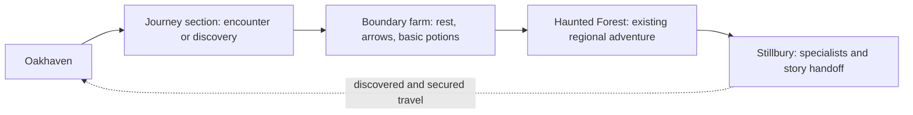

# World experience V2: the journey to the Castle of No Return

Design proposal for review, 2026-10-30. The three-active-quest limit is approved
as the first delivery, ahead of quest chains. Story, travel, and service changes
remain proposals. Assessment
is based on the current code, quest catalog, regional documentation, and world
map. Journey timings and prices below are playtest hypotheses, not measurements.

## 1. V1 baseline before the quest-limit delivery

| Current behavior | Consequence for V2 |
| --- | --- |
| 22 journal quests, but defeating Lord Veyr has no main-quest entry | Give the campaign a visible purpose from the beginning. |
| Most quests finish with gold/score and a return to their giver | Retain useful rewards, but add consequences and forward introductions. |
| Heartseed, Silent Expedition, Ironfang, and Giant's Crown already have ordered discoveries and actions | Extend these patterns into chapters rather than replacing working encounters. |
| Watchfires and Three Great Hunts already span regions; Veyra already offers two independent topics | Multiple locations and NPC topics exist, but need shared chain identity and prerequisites. |
| No acceptance limit; Active mixes unfinished work with rewards awaiting collection | Move finished objectives into Completed, identify pending rewards, and limit optional commitments. |
| Several older quest acceptances invalidate regional caches; newer quests add encounters in place | Standardize preservation before adding follow-up quests in explored regions. |
| Boss victories permanently secure through roads | Use those victories as visible story changes and foundations for faster repeat travel. |
| Physical re-entry can replenish ordinary enemies; backtracking within an expedition preserves state | A supply stop must not unexpectedly restart the player's expedition. |
| Oakhaven already differs from Stillbury, Rosemoor, Ridgeshire, and Dawnmere in services | Strengthen these identities; do not assume five identical blacksmith towns need deleting. |
| Health/Mana Potions cost 20 gold and fully restore; 20 arrows cost 10 gold | Measure travel and resting costs against these actual supply prices. |
| The ordinary loot path has a 10% base gold-drop chance; stock broadly follows boss counts | Longer journeys need predictable provisioning and more meaningful upgrade unlocks. |
| Return to Town is a zero-MP, one-way escape to the last entered town, with a castle exception | Preserve emergency retreat while adding a separate service for planned journeys. |
| Existing Teleport moves up to four tiles | Long-distance Mage travel needs its own spell and rules. |

Current sources: [quest catalog](../../quests.md),
[journal definitions](../../src/screens/quest_journal.c),
[quest acceptance and expedition logic](../../src/game/game.c),
[travel rules](../../src/game/boss_gates.c),
[actual regional connections](../../src/game/approach.c),
[shops](../../src/screens/shop.c),
[town residents](../../src/game/town_life.c),
[spells](../spells.md), and [loot](../../src/game/actions.c).
Some older documents still describe retired enemies, earlier stage counts, or
superseded connections; implementation takes precedence in this assessment.

The central problem is continuity: the player grows stronger, but the world
rarely explains what that strength is accomplishing. Distance alone will not
solve it. A longer journey needs discoveries, decisions, recovery, and a useful
destination.

## 2. Recommended story: End Veyr's Reign

Proposed fiction: Lord Veyr and the Royal Arcanist are renewing an old royal
oath that binds the dead to the crown. Broken burial seals, abducted wardens,
and purchased goblin weapons are different signs of the same expansion.
Isolated towns cannot resist together. The player exposes the plan, reconnects
communities, and carries the fight into the castle before its hold spreads.

Keep independent threats. The dragon can defend its territory, the giants can
guard their own history, and the coastal dead can have an older grievance.
They need a reason to matter to the journey, without all serving Veyr.

| Chapter | Player purpose | Progress and consequence |
| --- | --- | --- |
| Trouble at Home | Help Oakhaven and discover why the surrounding threats are worsening | Recommend Elowen's Broken Seals; Tamsin's Heartseed evidence supports a woodland-first route. Either reveals the crown's involvement. |
| Find a Way North | Follow one regional campaign toward an ally and an approach to the castle | Choose the eastern supply campaign, western relief campaign, or northern oath investigation. Other campaigns remain available. |
| Prepare the Assault | Turn discoveries into a practical advantage | Meet the relevant regional leader, establish a supply camp outside the castle, and receive a clear plan for the interior. |
| Break the Oath | Defeat the castle's defenders and end Veyr's rule | The Arcanist's existing ward mechanics express the story; Veyr remains the final victory condition. |

One regional campaign is enough for the recommended story route. Completing
the others adds different advantages, dialogue, and ending acknowledgments.
Do not require every regional boss or three interchangeable relics to enter.
Existing geographic boss gates still apply; early castle attempts remain
possible. If the player succeeds early, the main quest recognizes that victory.

| Campaign | Existing places and people | Proposed lasting result |
| --- | --- | --- |
| Eastern: The Crown's Supply Line | Elowen → Dain in Dawnmere → Marshal Veyra in Ridgeshire; Dungeon, Goblin Mountains, Ironfang | Evidence connects raids to royal purchases. Sabotage secures a quartermaster and removes one clearly identified, finite castle reinforcement group. |
| Western: The Broken Road | Alder and Bram in Stillbury → Selene/Orin in Rosemoor; Haunted Forest, Blackwater Swamp, optional Stonewake | Rescued people restore a relief route. A scout marks one optional castle side passage; the forward camp gains an ammunition and recovery allowance. |
| Northern: The Stolen Oath | Tamsin → Elowen → Brother Oswin; Elderwood and Royal Catacombs | The heartseed orders and burial ledger explain the binding. The player learns how to disable one additional outer ward source before the assault. |

The advantages are bounded and visible. They do not remove the Vampire,
Arcanist, or Veyr, and do not repeatedly reduce boss stats. All approaches must
remain viable for Warrior, Rogue, and Mage. Equal usefulness matters more than
an identical number of regions per campaign.

The physical northern route already crosses Elderwood and Catacombs. Oswin's
handoff should be available through a northern expedition contact, rather than
forcing a detour to Ridgeshire solely for his dialogue. This is proposed new
contact behavior, not an existing shortcut.

## 3. How a multipart quest would play

Prototype the eastern campaign because it follows existing forward travel:

| Part | Contact and activity | Why the next part follows |
| --- | --- | --- |
| 1. The Broken Seals | Elowen asks for the existing seal repairs. The restored inscriptions reveal a royal order. | Local unrest becomes evidence of a deliberate campaign. |
| 2. Follow the Payments | On return, Elowen pays the existing reward and offers an introduction to Dain. | Dain recognizes the suppliers' markings and can interpret the mountain fragments. |
| 3. Recover the Treasure Map | Keep Dain's fragment encounters, but let the reconstructed map also reveal a shipment route. | The route points toward Ironfang and gives Veyra actionable evidence. |
| 4. Break the War Machine | Veyra receives the evidence in Ridgeshire and offers the existing Ironfang mission. | Dumping weapons and obtaining the command seal stops an identified shipment. |
| 5. An Ally at the Gates | Report to Veyra, unlock the quartermaster, and hear the assault plan. | The player sees the practical result at the castle approach. |

Dain explicitly authorizes delivery to Veyra, who can settle his outstanding
reward. The player need not walk south just to close that step. Elowen's first
return remains useful: a local story revelation and preparation for leaving home.

Each part has its own reward-paid flag. A single chain entry groups its history,
current objective, contacts, and consequences. An NPC can offer the next part
immediately after rewarding the previous one, but acceptance is explicit.
Different NPCs can assign, advance, and conclude parts of the same chain.
Changing speaker must never duplicate rewards or create competing quest copies.

Use existing objectives where they fit. New parts should change the action or
stakes: investigation → rescue → sabotage → preparation. Avoid sending the
player through the same five floors again for an object that could have been
collected on the previous visit. When a return is necessary, change the encounter
or destination and explain why it has become relevant.

## 4. Give every existing quest a place

These are candidate roles, not a requirement to make every quest compulsory.
Keep existing paid rewards and unique equipment when adapting old saves.

| Existing quest | Proposed V2 role or follow-up |
| --- | --- |
| The Broken Seals | Opening investigation and introduction to Dain or Oswin. |
| Recover the Treasure Map | Eastern supply evidence; retain a genuine treasure payoff as an optional later part. |
| The Lost Wardens | Restore forest scouts and a route contact; rescued wardens can advance the chain. |
| Bring Mira Home | Personal stakes in the western relief campaign; Mira identifies an interrupted supply route. |
| The Stolen Heartseed | Northern evidence; healing the grove restores a waystation and gains Tamsin's support. |
| Rest for the Forgotten | Learn how the crown bound its dead; the ledger has a story use after its gold reward. |
| Break the War Machine | Direct, visible reduction of castle reinforcements. |
| Watchfires of Ridgeshire | Optional follow-up to Veyra's campaign; secure patrols and discovered travel connections. |
| Reclaim the Emberforge | Optional regional recovery; unlock an equipment improvement suited to the player's class. |
| Reclaim the Quarry | Restore construction supplies and improve a forward shelter; retain the hammer reward. |
| The Silent Expedition | Fen's maps identify a northern shelter and late-game supply route. |
| The Three Great Hunts | Optional guild challenge with separate regional turn-ins under one chain. |
| Relight the Drowned Beacons | Restore coastal navigation; work with Rowan on transport and the island lead. |
| The Buried Sun | Optional ancient history and a useful ward-related preparation reward. |
| The Missing Spice Skiff | Restore Dawnmere's caravan trade; introduce roadside provisioning contacts. |
| The Silent Stormbell | Make a coastal waystation safe; Seren becomes its travel contact. |
| The Lost Magic Lamp | Optional magical research with Zara; one possible lead toward advanced travel magic. |
| The Dragon's Hoard | A personal treasure story with Ilya; retain a useful equipment/progression payoff without requiring the dragon for the main story. |
| Giant's Crown | Historical evidence about the original oath, plus its existing reward; an optional deeper explanation. |
| The Ivory Rook | Keep a self-contained mystery and challenge. Rook can later recognize a castle diagram, without making the Labyrinth mandatory. |
| Guide Tomas Home | Optional rescue and firsthand castle intelligence; arrest is never a required main-story step. |
| Recover Your Equipment | Essential recovery task, exempt from optional quest capacity; retain confiscation and one-time recovery rules. |

Crown Roads become routes through the campaign, with scouts, patrol changes,
and the forward camp. They do not each need another unrelated collection quest.

## 5. Quest commitments and the journal

Recommend **one main story plus three active optional chains**. A chain occupies
one slot regardless of its number of parts or NPCs. The selected regional
campaign is shown inside the main story and is not charged a second slot.

The first delivery applies the three-slot limit to existing optional quests and
moves finished objectives into Completed, with pending rewards identified there.
Story, leads, pausing, and tracking follow with the chain framework; they are
not prerequisites for enforcing the limit.

- **Story:** current chapter, immediate next action, destination, and the reason
  it matters. Later chapters remain summarized or hidden to avoid spoilers.
- **Active (0–3):** accepted optional chains. Pin one next objective to the HUD;
  show area/stage and the next contact. Group by destination when planning a trip.
- **Completed:** assignments with finished objectives, including those awaiting
  NPC rewards. They stop consuming optional capacity immediately. Identify
  pending rewards in the entry; collecting one does not auto-accept the next part.
- **Leads / Paused:** discovered opportunities grouped by town, plus deliberately
  paused commitments. Do not reveal every undiscovered NPC's quest.
- **Bosses:** retain victories; Completed retains the quest history.

Allow pausing/resuming optional chains at safe settlements without losing
progress. A paused chain does not launch new quest encounters. Already placed
actors and physical changes remain; durable discoveries can receive credit
when it resumes. This cap controls focus, not the player's ability to remember
an inscription or defeat an enemy encountered naturally.

Essential escape/recovery tasks bypass the cap and appear prominently only
while relevant. A full journal never blocks Tomas's hatch or stolen belongings.
NPCs explain capacity plainly and leave offers available. No expiry timers or
punishment for declining a follow-up in the first version.

Old saves keep all accepted quests, even above the cap. Mark the temporary
overflow and prevent additional optional acceptance until it is resolved;
never silently abandon quests for the player. Pending rewards remain claimable.

## 6. Town identity and returning for a reason

Keep all five towns initially. Their positions already organize three approaches
to the castle. Replace redundant service functions before deleting settlements.
Every town should offer basic arrows and both potion types through an appropriate
vendor, plus access to affordable resting. Specialists sell the distinctive gear.

| Town | Identity | Reasons to return |
| --- | --- | --- |
| Oakhaven | Home, scholarship, general equipment | Story discoveries, Elowen's interpretation, Goldsmith rings/amulets, common weapons/armor, spell research. |
| Stillbury | Woodland and agricultural refuge | Alder/Bram developments, Healer/Witch, Cobbler boots, restored farms and western route contacts. |
| Dawnmere | Trading and coastal transport town | Belt Maker belts, Dain/Corvin/Seren, caravans, coastal transport and supply contracts. |
| Rosemoor | Frontier guild and expedition center | Regional commissions, Apothecary, scouting information, advanced hunts and northern preparations. |
| Ridgeshire | Military and industrial town | Veyra/Hadrin, existing Workshop and Fletcher, proposed advanced weapons/armor commissions and the assault council. |

Jewelry stays at Oakhaven's Goldsmith, boots at Stillbury's Cobbler, and belts
at Dawnmere's Belt Maker. Farm vendors do not duplicate these catalogs.
Blacksmiths primarily trade weapons/armor; any secondary smith should have
a distinct stock or service. No durability system is needed to justify repairs.

Initially retain current base stock unlocks. Add specific quest unlocks beside
them, then replace anonymous boss-count gates once every class has a viable
upgrade route. A shipment quest could enable an improved weapon, while a
research quest improves spell access. Avoid forcing every Mage or Warrior into
one particular regional campaign for essential power.

## 7. Longer journeys, farms, and reliable supplies

Preserve the recognizable geography and existing regional stages. Extend selected
connections into two or three short journey sections with landmarks, a branch,
and a safe stop. A five-stage region is already a substantial adventure;
do not add five stages of empty road in front of it.

This is a pacing diagram, not replacement geography. Keep the regional boss
checkpoint and physical retreat. Candidate stops include a woodland farm on
the Oakhaven–Stillbury approach, a trading farm on the Dawnmere approach, and a
refuge/camp between Elderwood and Catacombs. Harsh northern terrain should use
lodges or shelters where a farm would not make sense.

Farm rules for a first prototype:

- Rest restores HP **and MP** outside combat. Start testing at 5 gold for a full
  rest; show the exact effect and cost. No real-time wait or hunger simulation.
- Sell ordinary arrows and Health/Mana Potions. Keep arrows reliably available;
  do not make an empty quiver depend on a random merchant visit or stock timer.
  Start with current town prices and tune only after measuring the journey.
- Offer a short, safe chore in exchange for a rest when the player has no gold.
  It awards no XP, item stock, or main-quest slot. Ensure each major safe hub has
  a comparable recovery option, so zero HP/MP resources cannot trap a character.
- A farm quest can restore a route, grant a supply allowance, or reduce fees.
  Baseline shelter must be usable before accepting that quest.
- Place rests outside regional boss arenas. Reaching shelter requires a real
  retreat; potions retain their value during fights and long dungeon sections.
- A stop on a journey preserves that journey's encounters and dropped items.
  Do not trigger expedition regeneration merely by entering a farmhouse.

The existing adventure-economy proposal explicitly favored paid recovery over
free resting. This proposal changes where recovery is available while retaining
a price or small service exchange. Any later proposal for unlimited free rest
would require a separate potion/economy balance decision.

Use a short first-traversal segment, aiming for roughly 30–60 seconds between
meaningful landmarks on uncomplicated roads. Measure combat time separately.
After securing a route, routine resupply should take around a minute from a
safe point, or a few interactions through an unlocked transport service.
These are initial pacing targets to test, not existing travel times.

## 8. Teleportation and other repeat travel

| Option | Benefit | Cost or weakness | Recommendation |
| --- | --- | --- | --- |
| Walking only | Strong geography and expedition preparation | Repeated supply trips become chores | Use for first discovery and optional exploration. |
| Universal free instant travel | Very convenient | Town services and journey preparation lose meaning | Do not make it the initial model. |
| Paid wizard travel between discovered waystones | Supports all classes and gives useful spending choices | Fees can punish low-income characters | Recommended, with transparent fees and a physical alternative. |
| Late Mage travel spell | A satisfying class milestone | Could give Mages exclusive access or bypass encounters | Same destinations as wizards; privilege is independence and lower gold cost. |
| Caravans/ferries on secured routes | Fits towns and visibly rewards route repair | Extra UI and route maintenance if built alongside everything else | Add a small number after the wizard prototype works. |

Wizard travel unlocks only after visiting both endpoints and securing the
relevant route. A discovered destination across an unresolved boss gate is
insufficient. Start testing a 10–20 gold fee per trip; a necessary story handoff
can include a travel voucher. Walking and emergency recall remain available
when broke. Wizards must be reliably present, with occasional discounts or
story invitations rather than random availability.

Keep **Return to Town** as the existing one-way emergency escape, including
the castle restriction. Farms do not silently change its destination. Introduce
**Waygate** as a separate advanced Mage spell, learned through research and
a meaningful progression requirement. It connects attuned safe endpoints,
costs MP, and does not work during combat, an escort, or inside the castle.
Existing four-tile Teleport keeps its tactical role. No teleport arrives behind
an unopened boss or puzzle gate.

## 9. Main tradeoffs

| Decision | Advantage | Risk | Proposed choice |
| --- | --- | --- | --- |
| Fully linear campaign | Clear pacing and easy narrative sequencing | Loses the pleasure of choosing regions | A common purpose with three regional paths. |
| All regions mandatory | Every area receives attention | Checklist fatigue and very long replays | One main path, optional campaigns with distinct results. |
| Cap all quests, including recovery | Very small journal | Can block essential gameplay | Main story and essential recovery exempt; three optional chains. |
| Unique shops with no local basics | Strong town distinction | Arrows and potions become travel taxes | Local essentials, destination specialists. |
| Expand every road immediately | Larger-looking world | Empty walking and widespread migration risk | Prove one route and farm before expanding the network. |
| Make rewards mostly permanent stat bonuses | Immediate power feedback | Power inflation; optional quests become obligatory | Mix supplies, services, information, equipment, and bounded castle effects. |
| Require a castle key from every campaign | Strong apparent story gate | Restores the all-regions checklist | Preserve geographic gates and make preparation advantages explicit. |

## 10. Implementation sequence

Each numbered delivery is a review/playtest checkpoint; split its code further
where needed. Labyrinth gameplay polish remains a separate workstream.

1. **Active quest limit and completion.** Enforce three optional active quests,
   move finished objectives into Completed, free their slots, and preserve legacy overflow.
   Display capacity in the journal and blocked NPC offers. Escape and equipment
   recovery bypass the limit. Derive capacity from existing saved states.
2. **Quest chains and journal expansion.** Add stable quest/chain/NPC IDs and a small
   definition table with prerequisite facts, objective order, contacts, reward
   definitions, and world effects. Adapt existing quest handlers incrementally;
   do not replace every encounter with a scripting engine. Extend the journal
   with story, leads/paused, and objective tracking as their underlying state
   becomes available. Repair the existing detail-panel text clipping at 640×480,
   confirmed during the capacity renderer checks. Verify save migrations and
   the full chain lifecycle.
3. **One connected story sample.** Implement Elowen's follow-up and Dain-to-Veyra
   handoff, reusing their existing encounters. Test forward turn-in, early
   discoveries, reward delivery, and why the player wants to continue.
4. **One farm and journey.** Add a short approach section, a usable farm, reliable
   supplies, and a recovery path from zero gold. Compare supply-trip time and
   encounter resets against V1. Build art through the existing pixelkit pipeline.
5. **A two-endpoint wizard service.** Test Oakhaven and one physically discovered,
   secured regional town. Verify fees, destination safety, and route restrictions.
6. **Regional campaigns and town consequences.** Complete the chosen story paths
   incrementally; add their specialist unlocks and forward camp behavior.
7. **Castle consequences and ending.** Apply each bounded preparation effect,
   expose it in the assault briefing, and acknowledge the player's allies at
   victory. Test rushing the castle and completing extra campaigns as well.
8. **Expand proven travel and tune the economy.** Add more useful stops and Mage
   Waygate, then adjust supply income and upgrade availability using class runs.
   Redraw the atlas only after playable connections are settled.

Companions, rolled attributes, armor-class combat, and real-money gold are
separate roadmap projects. Combining them with this overhaul would obscure
whether the story and travel changes improved the game.

Persist accepted/current/paused stages, objective facts, claimed reward IDs,
world consequences, discovered travel endpoints, and any supplies or vouchers.
Apply facts once across death, repeated dialogue, travel, and save/load. Evidence
and introductions stay outside the equipment/inventory capacity system.

Legacy quest progress and boss victories must satisfy equivalent new objectives
without replay. Keep already earned stock access and rewards. New quest
acceptance inserts missing encounters without clearing active or cached maps.
Map changes must preserve exploration, wounded enemies, loot, all equipment,
confiscated belongings, and existing routes; migrate and back up saves as
required by the repository rules.

## 11. What the playtest must establish

- Within the opening session, a new player can explain who threatens the realm,
  why their next destination matters, and how it relates to the castle.
- Complete one whole story path with each class. Record compulsory travel,
  optional detours, gold earned/spent, arrows/potions used, and gear/spell access.
- A returning player can find the next action quickly; no chain creates multiple
  competing active entries, and no offer or handoff silently exceeds capacity.
- Test finishing objectives before acceptance, changing the active campaign,
  pausing, a full inventory, repeated turn-ins, and save/load between every part.
- Verify recovery from 1 HP, 0 MP, 0 arrows, 0 gold, and no potions at each major
  safe hub. Recovery cannot depend on an unfinished combat quest or random drop.
- No mandatory round trip exists only to buy arrows; every planned specialist
  return should also offer a new item, story development, or useful service.
- Test the shortest castle route and a heavily prepared route. Additional
  campaigns help visibly without making the final battle trivial.
- Test actual transitions and continuous routes across multiple map seeds,
  supported terrain states, active/cached save migrations, and both directions.
  Inspect farm art, exit labels, minimap markers, and destination UI in the renderer.

The three-active-quest limit and its priority ahead of chains are approved.
The story premise, town roles, and paid rest/discovered travel model remain
proposals for review. Detailed dialogue, exact
fees, map distances, and castle modifiers can then be approved in small,
playable steps.
