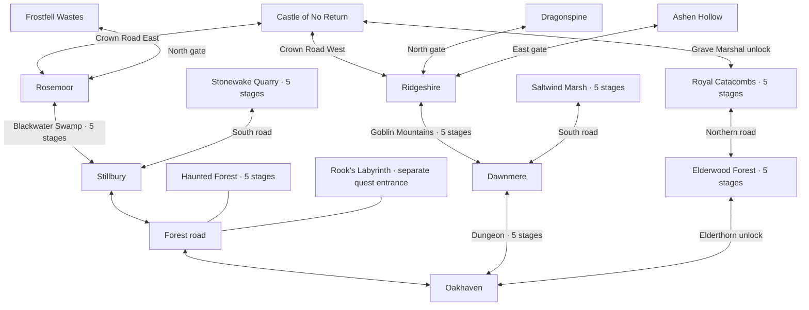

# Five-town world expansion

Status: The five-town expansion and safe regional entrances are implemented.
Elderwood Forest replaces the planned Windscar Highlands north of Oakhaven.
Its five stages and the relocated Catacombs form a third route to Castle Grounds,
with each boss unlocking its own section. See [Elderwood](elderwood-forest.md).

## Main travel routes

Both castle routes cross two enemy regions and one Crown Road. With the revised
five-level forest, swamp and mountain adventures, both routes have 10 regional
stages.
Equal region counts are the goal; equal stage counts or play times are not
required. Elderwood and Catacombs now provide an additional northern castle
connection.

Geographically, place Oakhaven south of the castle, with Stillbury and Rosemoor
to the west, and Dawnmere and Ridgeshire to the east. Dawnmere is directly east
of Oakhaven and south of Ridgeshire. Goblin Mountains moves between Dawnmere's
north gate and Ridgeshire's south gate. Frostfell and Dragonspine remain the
northernmost cold regions; Ashen Hollow stays east of Ridgeshire. All other
existing connections remain in place.

Dawnmere occupies open coastal lowland, with the mountain foothills north of
town. The northern road climbs through Goblin Mountains to elevated Ridgeshire;
Dawnmere itself is not surrounded by peaks. The eastern headland remains open
for the final regional adventure; see the [eastern area concept shortlist](dawnmere-east-design.md).

## Dungeon and the Lich-unlocked road

- Keep the dungeon accessible from Oakhaven before defeating the Lich King.
- The dungeon is one building with a western entrance from Oakhaven and an
  eastern entrance from Dawnmere. **Both entrances start at stage 1.** Play
  stages 1 through 5 in the usual order. Never reverse the dungeon's floors.
- Add a signed town connection that unlocks when the Lich King is defeated.
  It uses the existing Lich victory flag, including in older completed saves.
- Exiting the defeated Lich's chamber leads onto a safe connecting road. The
  player physically walks **west to Oakhaven** or **east to Dawnmere**.
- Keep the choice on that road: no town-selection prompt, direct arrival in a
  town, or second path that reverses the player's travel direction.
- Use the town grass and cobblestone approach visuals, open road continuations
  at either end, and signs naming both towns. Town sprites stand beyond those
  road boundaries. Keep the existing lich crypt art.
- Normal dungeon retreat returns to the approach for the entrance used.
  Physical retreat remembers that entrance town. Return-to-town spells use the
  last town actually visited; the portal retains the original expedition.
- Preserve the Lich encounter, keys, burial-seal quest, rewards, exploration,
  caches, loot confirmation, and repeat-expedition behavior.

## Dawnmere and the relocated mountains

Dawnmere needs a walkable town square, a western dungeon connection and a
northern mountain gate. Use established town building assets and gate styles.
New shops, quests and bespoke buildings are outside this first expansion.

The mountains now use five levels, always starting at level 1 from either town.
A large mountain cave stands beside a straight cobblestone road. Defeating the
Goblin King on level 5 opens the road; exiting his chamber returns to it, with
Ridgeshire north and Dawnmere south. There are no mountain shortcuts or boss
branches. Dain's bearers occupy levels 2–4; Veyra's mountain watchfire is on 5.
Oakhaven's north gate now leads to Elderwood Forest and the boss-gated northern
Castle road. The mountain roster and existing progress remain independent.

## Implementation and save compatibility

- Append new location and tile IDs. Preserve existing serialized IDs and the
  indices of unrelated `town_approaches` entries.
- Add explicit dungeon entrance-town and portal-town state, serialized and
  deserialized in `src/systems/save_load.c`. Older dungeon saves default to
  Oakhaven. Entrance side changes the return destination, never stage order.
- Migrate old mountain entrance/portal references from Oakhaven to Dawnmere.
  Migrate players saved on the former Oakhaven mountain approach to the moved
  mountain approach, preserving their position along the path, exploration,
  loot and facing. Do not reinterpret an old mountain approach as Elderwood.
- Preserve boss victories, quest progress, equipment, gold, regional caches,
  active portals and saved enemies. Existing Lich victories open the new road
  immediately without replaying the boss.
- Serialize any Elderwood cache, progress or completion state. New location IDs
  exceed the existing integer boss-bit range: audit location-based bit shifts
  and represent new completion state safely rather than shifting by a new ID.
- Update town rendering, music, safe-area handling, labels, portal destinations,
  map artwork and its source notes, README and regional documentation together
  with the playable connections they describe.

## Required regression checks

Verify a new character can enter and render the original dungeon, retreat to
Oakhaven's approach, and cannot use the locked town connection. Defeat the Lich,
exit his actual chamber, and physically reach either town in the correct
direction. Enter the dungeon from both towns and verify stage 1, forward
descent, correct retreat, and portal round trips. Test both mountain entrances,
level-1 entry, retreats, summit exits, road traversal and portals with Dawnmere
as the southern town.

Load saves from before the expansion in Oakhaven, on its old mountain approach,
inside the dungeon and mountains, and with active portals and completed bosses.
Check preserved progress, walkable spawns and reachable loot. Check Elderwood's
independent persistence and safe approach. Inspect both new destinations in the
actual renderer. Confirm the two castle routes each have three travel legs.

Rook's Labyrinth now stands beside the Haunted Forest entrance on the shared
Oakhaven–Stillbury road. The gate is sealed until Rook assigns his quest in
Oakhaven's Tavern; both approaches can reach it before the forest boss falls.
Its maze content is unchanged, and physical exits return to the approach used.
The illustrated world map includes this entrance and all five towns.

## Optional town visits

Oakhaven, Stillbury, Rosemoor, Ridgeshire and Dawnmere now have walled sprites
beside safe exterior roads. Walking into a connected cardinal side of a town
sprite enters beside the matching interior exit gate. Players can bypass any town and continue to another
existing regional approach or Crown Road. Regional boss locks remain in force;
Elderwood and Catacombs gate the northern castle road. Stillbury's south road reaches Stonewake Quarry, and Dawnmere's south road
reaches [Saltwind Marsh](saltwind-marsh.md). Dawnmere's east road remains
closed and available for a future region. Rowan and the docks are on the
Sunken Coast approach outside Oakhaven. Pirate Coast and its merchant quest are retired. See
[town roads](town-roads.md) for the connection table and save behavior.
