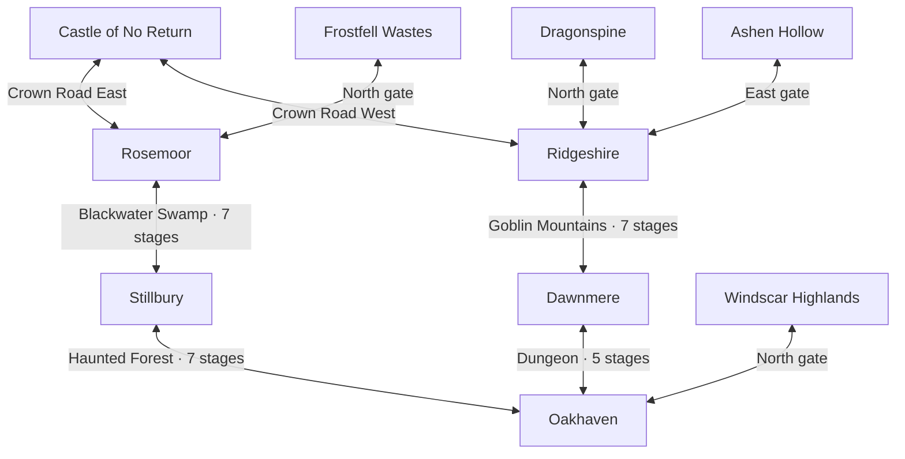

# Five-town world expansion

Status: Dawnmere and the Lich-unlocked dungeon road are implemented in the first
gameplay change. Mountain relocation, Windscar Highlands and revised illustrated
map artwork remain for subsequent change sets.
**Dawnmere** is the fifth town. The new northern region is
**Windscar Highlands**, with windswept hills and ruined watchtowers.

## Main travel routes

Both castle routes cross two enemy regions and one Crown Road. Preserve existing
depths: the western route has 14 regional stages and the eastern route has 12.
Equal region counts are the goal; equal stage counts or play times are not
required. Windscar Highlands is a side destination rather than another castle
connection.

Geographically, place Oakhaven south of the castle, with Stillbury and Rosemoor
to the west, and Dawnmere and Ridgeshire to the east. Dawnmere is directly east
of Oakhaven and south of Ridgeshire. Goblin Mountains moves between Dawnmere's
north gate and Ridgeshire's south gate. Frostfell and Dragonspine remain the
northernmost cold regions; Ashen Hollow stays east of Ridgeshire. All other
existing connections remain in place.

## Dungeon and the Lich-unlocked road

- Keep the dungeon accessible from Oakhaven before defeating the Lich King.
- The dungeon is one building with a western entrance from Oakhaven and an
  eastern entrance from Dawnmere. **Both entrances start at stage 1.** Play
  stages 1 through 5 in the usual order. Never reverse the dungeon's floors.
- Add a signed town connection that unlocks when the Lich King is defeated.
  It uses the existing Lich victory flag, including in older completed saves.
- Exiting the defeated Lich's chamber leads onto a safe connecting road. The
  player physically walks **west to Oakhaven** or **east to Dawnmere**.
- Keep the choice on that road: no town-selection prompt, direct arrival in a
  town, or second path that reverses the player's travel direction.
- Use the town grass and cobblestone approach visuals, matching town gates at
  either end, and signs naming both towns. Keep the existing lich crypt art.
- Normal dungeon retreat returns to the approach for the entrance used.
  Return-to-town spells and portals remember that entrance town as well.
- Preserve the Lich encounter, keys, burial-seal quest, rewards, exploration,
  caches, loot confirmation, and repeat-expedition behavior.

## Dawnmere and the relocated mountains

Dawnmere needs a walkable town square, a western dungeon connection and a
northern mountain gate. Use established town building assets and gate styles.
New shops, quests and bespoke buildings are outside this first expansion.

Keep the mountain region's seven stages and Goblin King encounter. Dawnmere
enters stage 1; Ridgeshire enters stage 7. Keep the existing physical crossroads:
area straight, other town left, boss right, relative to departure from town.
The two side arms remain hidden until the Goblin King is defeated. Mountain
return paths, portals, signs and NPC directions must name Dawnmere in place of
Oakhaven. Oakhaven's north gate leads only to Windscar Highlands.

Windscar Highlands needs its own safe approach and distinct regional identity.
Its depth, encounters, boss and rewards are a separate, small content change;
moving Goblin Mountains must not silently change its enemies or existing saves.

## Implementation and save compatibility

- Append new location and tile IDs. Preserve existing serialized IDs and the
  indices of unrelated `town_approaches` entries.
- Add explicit dungeon entrance-town and portal-town state, serialized and
  deserialized in `src/systems/save_load.c`. Older dungeon saves default to
  Oakhaven. Entrance side changes the return destination, never stage order.
- Migrate old mountain entrance/portal references from Oakhaven to Dawnmere.
  Migrate players saved on the former Oakhaven mountain approach to the moved
  mountain approach, preserving their position along the path, exploration,
  loot and facing. Do not reinterpret an old mountain approach as Windscar.
- Preserve boss victories, quest progress, equipment, gold, regional caches,
  active portals and saved enemies. Existing Lich victories open the new road
  immediately without replaying the boss.
- Serialize any Windscar cache, progress or completion state. New location IDs
  exceed the existing integer boss-bit range: audit location-based bit shifts
  and represent new completion state safely rather than shifting by a new ID.
- Update town rendering, music, safe-area handling, labels, portal destinations,
  map artwork and its source notes, README and regional documentation together
  with the playable connections they describe.

## Required regression checks

Verify a new character can enter and render the original dungeon, retreat to
Oakhaven's approach, and cannot use the locked town connection. Defeat the Lich,
exit his actual chamber, and physically reach either town in the correct
direction. Enter the dungeon from both towns and verify stage 1, forward
descent, correct retreat, and portal round trips. Test both mountain entrances,
Goblin King shortcuts and boss returns with Dawnmere as the southern town.

Load saves from before the expansion in Oakhaven, on its old mountain approach,
inside the dungeon and mountains, and with active portals and completed bosses.
Check preserved progress, walkable spawns and reachable loot. Check Windscar's
independent persistence and safe approach. Inspect both new destinations in the
actual renderer. Confirm the two castle routes each have three travel legs.
