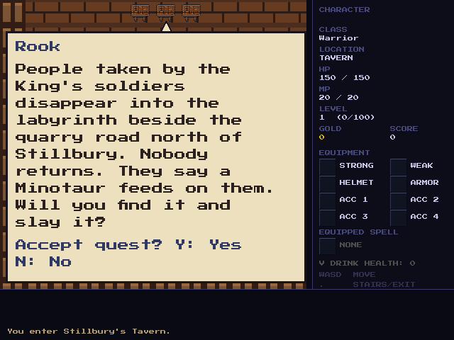
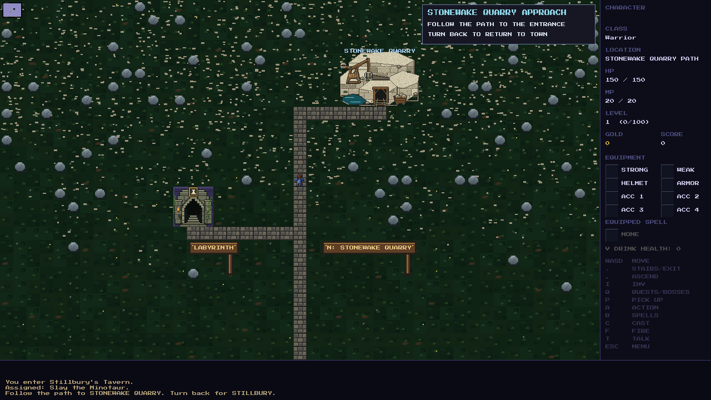
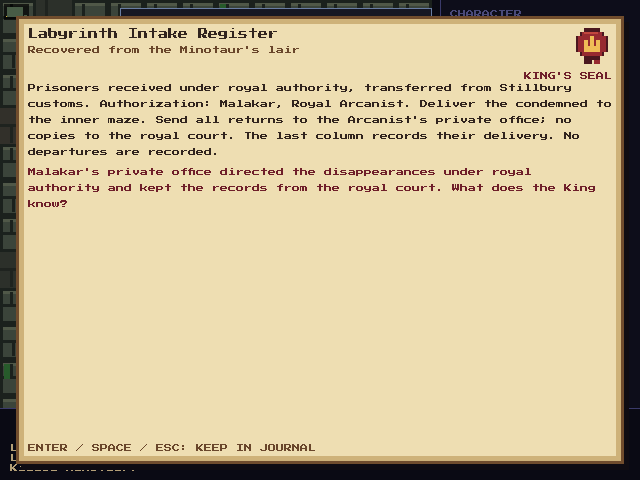

# Labyrinth arc validation

- Native Debug builds: `conr`, `test_runner`, `debug_shortcuts_test`.
- Gameplay runner: **8,354/8,354 checks passed**.
- Three seeds exercise real town departure, the quarry entrance with the
  Minotaur alive, optional maze entry, all five floors in both directions,
  loot-covered stairs and retreat to Stillbury.
- Quest coverage checks explicit acceptance, the active limit, immediate payout,
  victory before acceptance, evidence/read-state persistence and repeat-reward
  prevention. The new northern town entrance retains the wanted checkpoint.
- Save fixtures repair old active and cached runes, gates, relics and false
  stairs without regenerating maps or resetting wounds, exploration and loot.
- Native SDL review at 1280x720 and 640x480 covers Rook, the offer and journal,
  both roadside landmarks, maze stairs, Minotaur combat, reward and register.
  The real local version-240 character loads; a separate version-241 maze
  fixture is loaded and rendered with its 43 HP and cached enemy wounds intact.
- README's embedded and linked atlas use the SHA-256-versioned final asset.

The full debug-shortcut runner was not executed; its separate boss-gate
fixture still assumes a dungeon checkpoint that predates the V2 rewrite.
The dedicated native labyrinth review exercises the current arc directly.

The [map edit prompt](world-map-prompt.md) records the built-in imagegen edit.
