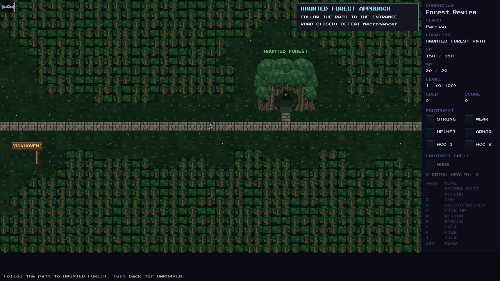
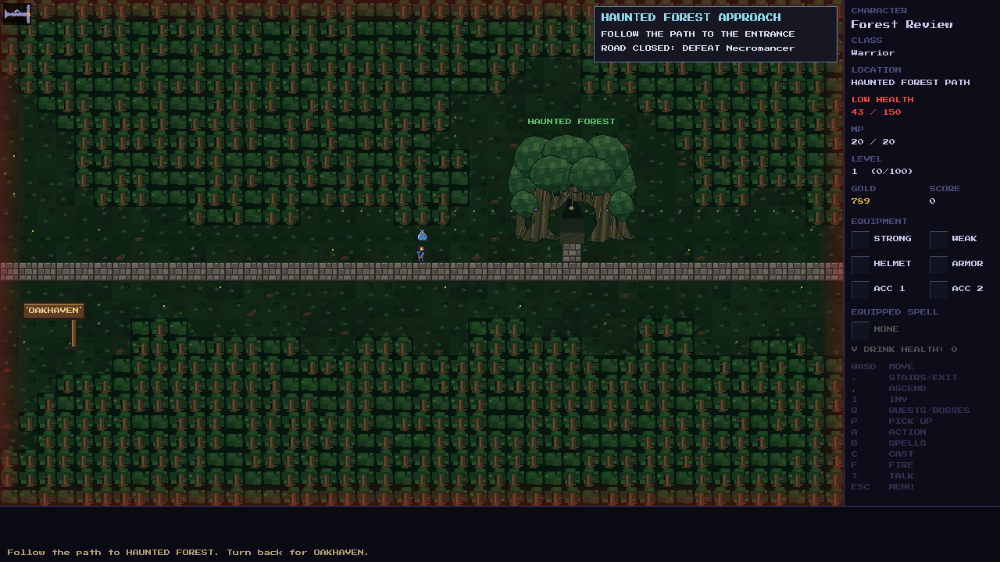

# Rook's Labyrinth — Minotaur encounter

**Deferred in V2.** The labyrinth is outside the current Oakhaven, Haunted
Forest and Goblin Mountains story arc. Its forest-road entrance, label, spur,
travel trigger and final world-map landmark are removed. Rook is already absent
from Oakhaven, so no current NPC offers his quest. Old quest acceptance and the
debug passage override cannot reveal an entrance.

The maze implementation, art, cached expeditions and existing quest progress
are retained for its later return. Older forest-road saves lose only the
retired landmark footprint and spur; exploration, wounds, inventory, dropped
loot, quests and boss victories remain intact. A save inside the maze remains
loadable and can retreat to the actual forest road beside the forest entrance.
That retreat does not restore outdoor access to the labyrinth.

The canonical README map is updated in place; its [built-in imagegen edit
prompt](labyrinth-removal-map-prompt.md) records the exact removal constraints.

## V2 deferral validation

The native build and **6,868/6,868** gameplay assertions pass. Forest-road
checks cover three seeds from both approaches with ordinary play, an old Rook
quest, the Necromancer defeated and debug passages unlocked. They exercise
actual forest entry, retreat and onward travel. Save tests preserve loot,
exploration, quest progress and cached labyrinth wounds, and verify that a
legacy expedition can still leave safely. The repair runs on every save
version when the retired marker is present; approach maps are not cached
combat stages, and the maze's own cached stages are unchanged.

Native SDL review covers a fresh road, an older approach repaired on load,
and an existing saved character, with 1280×720 and 640×480 views. The original
local save was read through an isolated copy and its checksum stayed unchanged.

## Retained design for later placement

Five maze floors each hold a rune. All five runes open the final vault gate;
the Minotaur must fall before the player can take the ivory rook. The existing
one-time quest reward is 40 gold and 500 score. Its future location and quest
giver placement will be designed in a separate change.

## Scrolling camera

The maze uses the shared 1.5× camera, with square 36-pixel tiles and scrolling
bounded to its existing 43×25 floors. Stair labels identify the next floor or
the return to the forest road; both descents keep the same label so the false
stair remains a puzzle. Labels stay inside the play area, and discovered stairs
appear on the compact minimap. Existing maps and saved progress are unchanged.

For playtesting, check the entrance and both descents, retreat between floors,
and the fifth-floor gate, pillars and Minotaur warnings. Resize the window while
moving near the maze edges and confirm the sidebar and stair labels stay clear.
True and false stairs, runes, gate, relic and regular maze enemies keep their
existing behavior.

## Phases and warnings

The Minotaur retains **120 HP, 18 attack, 7 defense and 250 experience**. Attacks
use normal defense mitigation, with a minimum of 1 damage. The closed rune gate
blocks engagement. A clear nearby line starts the encounter; damage from a
ranged approach also engages him. He charges along the last floor's walkable
lanes and never crosses stairs or overwrites runes, gate, relic or maze walls.

- **Vault Keeper, above half health:** a one-action fixed charge lane when
  farther away, or a one-action three-tile frontal axe sweep when close.
- **Bloodied Bull, at/below half health:** two charges, each with its own fresh
  one-action warning and recovery, followed by a two-action wide axe arc.
  Crossing half health during a warning never changes that queued attack.
- Charge lanes are horizontal or vertical and reach at most six tiles. Their
  endpoint and collision target lock before movement. A player standing in
  the lane takes one hit; the Minotaur stops before the player instead of
  sharing a tile. Newly entering actors can stop the charge early, but removing
  cover cannot extend an already warned endpoint.
- The short axe covers three tiles in front. The wide axe adds flanking tiles
  beside the Minotaur and expands the frontal row to five tiles. Both use the
  same fixed tile predicate for warnings and damage. Normal walking can escape
  within their advertised countdown.
- In single-file approaches, a charge that would prevent a one-action escape
  shortens to the aimed tile so the player can step back. If no safe walk exists,
  the attack becomes an empty swing. The map receives no invisible barriers.

Numbered outlines and directional arrows mark exact charge lanes; slash symbols
mark axe attacks. The panel shows the phase, attack countdown and remaining
recovery actions. Frozen warnings retain targets and pause their countdown;
freeze also pauses recovery. Retreat beyond 12 tiles pauses the exact pending
attack without healing or moving the boss. Opening inventory or the journal
advances no encounter clocks.

Every signature leaves **one full recovery action** without an extra adjacent
retaliation. The Minotaur remains damageable throughout. Baiting an announced
charge into an ordinary wall or reinforced pillar instead grants **two full
actions of stagger**. Players can counterattack during both actions.

## Reinforced pillar caps

Two vault pillars provide optional, equipment-free counters for every class.
Their solid caps block walking and targeting. A charge aimed at a reinforced
pillar displays **C1**, plus an explicit crack warning, before impact. The first
impact cracks its cap while keeping it solid. In Bloodied Bull, a later charge
into that cracked cap displays **B1** and an explicit break warning; its impact
breaks the cap into walkable rubble, opening a flank. **H1** marks other planned
stone impacts. Collision labels identify the obstacle; those solid tiles are
not themselves damage tiles.

Only these two designated caps can break. Ordinary maze walls, the rune gate,
stairs, switches and ivory rook remain intact. Cracked/broken cap state persists
through floor backtracking and saves. A living fifth-floor encounter also
survives retreat to the forest road and re-entry, retaining health, targets, freeze,
charge sequence and pillars. Other floors still start fresh on a new expedition;
completed expeditions retain the existing regular-enemy refresh behavior.

## Labyrinth Aegis and save compatibility

Future victories guarantee **Labyrinth Aegis**: a rare, **Warrior-only** shield
with **+9 defense, 25% block chance and value 1,250**, matching the old Magic
Shield. Its bronze rim, bull emblem and cyan runes appear in inventory, equipped
icons and the player's off hand. Existing Magic Shields retain their identity,
art and shop availability; no class or shop progression changes are introduced.

The reward normally drops with boss gold. Full floor-loot capacity reserves it
in the bull-marked vault cache without deleting other loot. If every uncovered
vault tile is occupied, the cache can safely sit beneath existing loot. Interact
on or cardinally beside it with contextual **`A`**, or press **`P`** on it.
Full inventory leaves the reward available. Leaving an earned reward unclaimed
restores it in the cache after a floor refresh. Claiming permanently prevents
replacement after sale or deliberate dropping.

Save version **129** adds `minotaur_reward_state`: 0 not earned, 1 unclaimed
Aegis, 2 claimed, and 3 identifiable unclaimed legacy Magic Shield. Existing
enemy fields store phase, sequence, countdown, orientation, endpoint and collision
coordinates in active/cached encounters. Appended tile IDs preserve pillar and
cache state; a new appended item visual ID preserves the Aegis artwork.

Older living fights migrate in place with visible new warnings, preserving
health, deaths, positions, exploration, gear, loot and all rune/quest progress.
Old victories remain completed without inventing another shield. An identifiable
current dropped legacy Magic Shield remains recoverable as **Magic Shield**,
including after saving again; it is never retroactively renamed to Aegis.

## Entrance relocation and older saves

Save version **176** records `labyrinth_entry_town`, so loading inside the maze
retains the correct return approach. Older maze saves default to Stillbury's
forest approach. Their floors, enemies, Minotaur state, runes, relic, boss victory
and quest completion remain intact. Old Stillbury saves remove the gate and its
spur, retaining the square's cobblestones, player position, exploration and loot;
items covering the removed gate receive grass underlays. Saved forest approaches
gain the landmark, with blocked players and loot moved to accessible road tiles.

