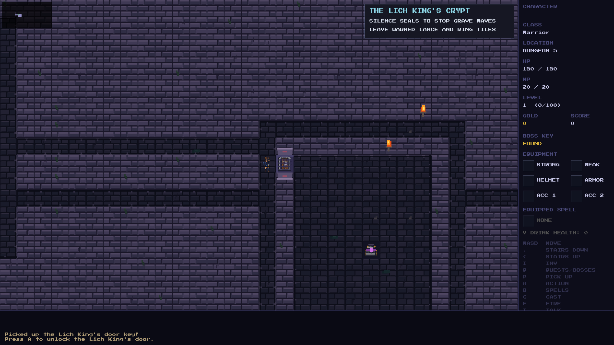

# Manual unlocking in Oakhaven's dungeon

Walking into a locked crypt or Lich King chamber door now stops the player.
With the matching key, the status log says **Press A to unlock**, using the
player's remapped Interact key when applicable. Without it, the door identifies
the missing key. Press Interact beside the door to consume one matching key
and open it; a separate movement steps through.

The door the player is facing takes priority if multiple doors are adjacent.
Arrow keys remain movement controls. Frozen players cannot unlock doors, and
debug-unlocked passages retain their existing bypass behavior.

`game_locked_door_target()`, the dungeon door helpers, and
`action_resolve_player()` in `src/game/actions.c` implement the targeting,
prompt and explicit opening. The existing contextual Interact dispatch in
`src/main.c` recognizes the adjacent door through
`game_has_regional_interaction()`. Existing saved key counts, facing and map
tiles preserve closed/open states; no new persistent field is introduced.

The headless test runner now links SDL2 core so its remapped key labels use the
same `SDL_GetScancodeName()` implementation as the game; it still requires no
window or audio mixer.

Validation:

- Native game and test runner builds pass; **6,491 / 6,491 tests pass**.
- Both door kinds are checked from all four sides, including wrong keys,
  facing priority, freezing, a remapped key, key consumption, separate movement
  and save/load before and after unlocking.
- Existing dungeon route and Elowen rescue checks now perform explicit
  unlocking before stepping through, preserving their reachability coverage.
- Eight generated key-to-door SDL journeys across four seeds use **655
  movement actions**, the application's actual contextual key dispatch, and
  saved closed doors. The default prompt, [remapped prompt](boss-remapped.png)
  and [opened crypt](crypt-open.png) were inspected in the game renderer.
- `git diff --check` passes. Existing NPC artwork edits were preserved.

Suggested manual commit: `Require Interact to unlock keyed dungeon doors`.
