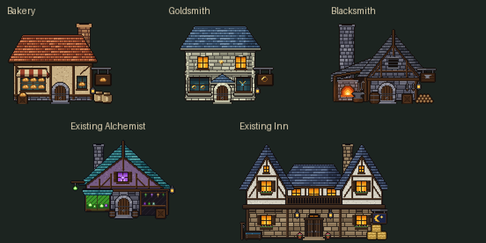

# Oakhaven shop variety

Approved Act 1 art change, 2026-11-01. The bakery, goldsmith and blacksmith now
have distinct architecture and trade details. Their dedicated Oakhaven variants
use the established pixelkit surfaces, masonry, timber, doors and outlines.

- **Bakery:** a low, wide red hipped roof, warm timber-framed plaster, cream/red
  awning, bread display windows, loaf sign and flour sacks.
- **Goldsmith:** a taller pale limestone facade, blue slate roof, upper windows,
  glazed ring/necklace displays, layered doorway and gold ring sign.
- **Blacksmith:** a dark stone gable, tall chimney above the open forge, iron
  louvers, wall-mounted blades and outdoor anvil.

## Scope and reproduction

Only Oakhaven selects these new textures. Dawnmere and every other town retain
their existing artwork; all pre-existing BMPs remain byte-identical. No town
layout, geography, collision, shop stock, NPC, game state or saved-map field is
changed. The blacksmith's original shared texture also remains available.

Run `python3 tools/sprites/local_buildings.py` and
`python3 tools/sprites/blacksmith.py`, or `make sprites`, to reproduce:

- `assets/images/oakhaven-bakery.bmp`
- `assets/images/oakhaven-goldsmith.bmp`
- `assets/images/oakhaven-blacksmith.bmp`

These are alpha BMPs at native 120×96 resolution (5×4 tiles). Doors retain their
established bottom-center position and scale. Oakhaven-specific renderer
selection keeps the new bread displays out of the shared texture used by
Dawnmere's merchant. The renderer releases the three additional textures during
normal cleanup and falls back to the prior artwork if a variant is unavailable.

## In-game review

All captures use the actual SDL game renderer at 1280×720:

- [Before](before.png) and [after](after.png), from the same town position.
- [Bakery doorway](bakery-door.png): bread display and a clear front step.
- [Goldsmith doorway](goldsmith-door.png): pale masonry, jewelry and an open
  approach to the centered door.
- [Blacksmith doorway](blacksmith-door.png): forge chimney, hearth and anvil,
  inspected beside the existing Inn.

The north-road sign and other reported Act 1 playtest issues are outside this
art change and remain separate follow-up work.

## Validation

- The game builds successfully.
- Native SDL checks load all three textures at 120×96 with transparency.
- Three seeded Oakhaven runs (8200–8202) complete nine continuous shop journeys
  with **240 real movement actions**: street → actual doorway → NPC/counter →
  actual exit → the original doorstep. The bakery conversation and the two
  appropriate equipment shops remain available.
- The same-scale sheet and all three actual doorway views were inspected.
- Regeneration is deterministic, preserves all original BMPs and retains the
  established doorway geometry. No new gameplay unit tests were added for this
  visual change.
- `git diff --check` passes. Changes remain uncommitted for manual review.
