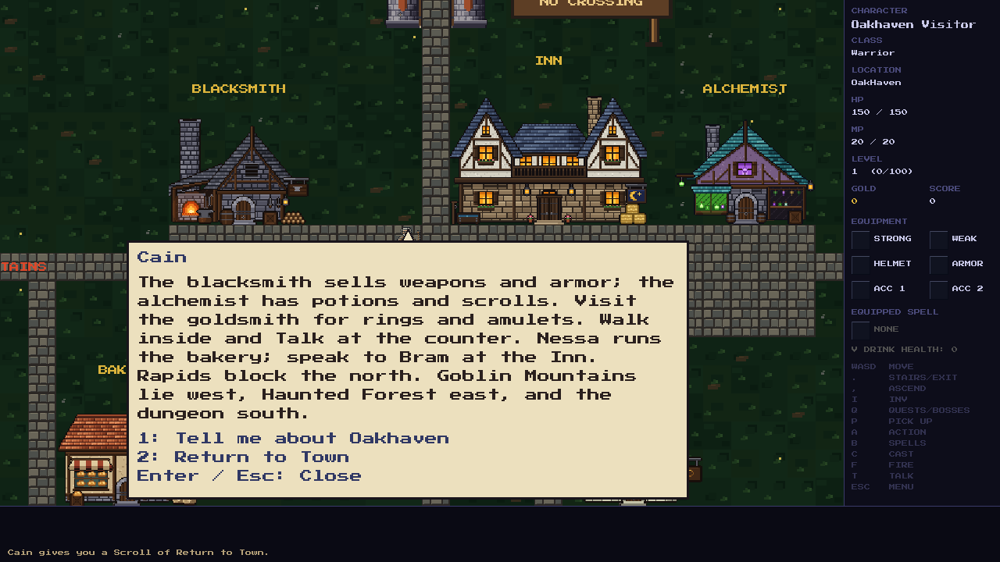

# Cain's optional town guide and Bram's rescue dialogue

Talk to Cain at Oakhaven's crossroads. He gives his one-time Return to Town
scroll if the pack has room, then offers two topics:

| Key | Topic |
| --- | --- |
| 1 | Tell me about Oakhaven |
| 2 | Return to Town |
| Enter / Esc | Close the conversation |

The optional guide explains the blacksmith, alchemist, goldsmith, bakery and
Inn, including walking inside and talking at shop counters. It also describes
the current Act 1 roads and the northern rapids. The other topic explains the
scroll and the spell's one-way return. The gift remains available if the pack
is full; changing topics never duplicates it or starts a quest.

Bram's rescue offer now concerns Elowen and the Lich King alone. Once accepted,
he gives a shorter reminder. His reunion, 80-gold reward and subsequent thanks
retain their existing behavior.

## Implementation

`src/game/game.c` keeps the two topics in `game_talk_to_cain()` and
`game_handle_cain_dialogue_key()`. The existing saved speaker, text and active
dialogue fields retain the selected topic, alongside `cain_scroll_given`.
There is no new persistent field or save format.

`src/main.c` handles Cain's topic keys before gameplay commands and blocks
world clicks while the conversation is open. Held keys do not repeat topic
actions. `draw_dialogue_bubble()` in `src/renderer/game_renderer.c` displays the
choices below either topic. `game_talk_to_bram()` selects the focused rescue
offer, accepted reminder, reunion or final thanks according to quest progress.

## Review and validation

- Native game and test runner builds pass; **6,421 / 6,421 tests pass** in a
  temporary save directory.
- Unit checks cover optional guidance, topic switching, repeated keys,
  closing/reopening, no input capture outside Oakhaven, full-pack behavior,
  the one-time gift, save/load and Bram's accepted reminder.
- The actual SDL renderer was inspected at 1280×720 and 640×480 for the gift,
  guide, portal instructions, full-pack message and Bram's offer/reminder.
  The reward was also checked to pay once.
- [Scroll gift](cain-gift.png), [small-window guide](cain-guide-small.png),
  [Bram's focused offer](bram-offer.png) and
  [small-window offer](bram-offer-small.png).
- `git diff --check` passes. Changes remain uncommitted for manual review.
