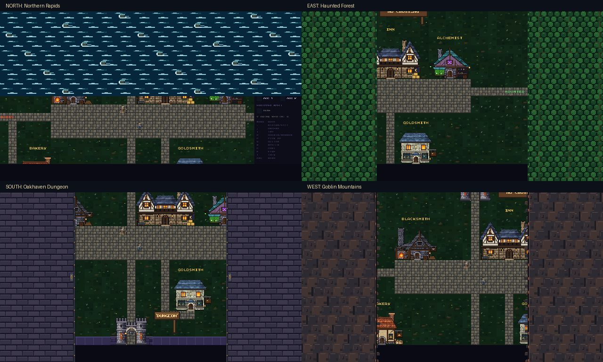

# Oakhaven departure animations

Oakhaven's visual transitions now follow its playable connections instead of
the former compass layout:

| Exit | Destination | Animation |
| --- | --- | --- |
| North | Northern Rapids riverbank | White water flowing east around river rocks |
| East | Haunted Forest | Forest canopy |
| South | Oakhaven Dungeon | Dungeon stonework |
| West | Goblin Mountains | Mountain cliffs |

The north animation descends from the top of the screen, then withdraws to
reveal the safe riverbank. It does not represent a crossing; the broken ferry
and impassable river retain their existing behavior.

## Implementation

`town_entry_style()` in `src/main.c` reads Oakhaven's destination from
`town_road_connection()` and selects its effect. Other towns retain their
existing selection logic. The existing 240ms close, 100ms hold and 260ms open
timing stays in place, and the pending movement still resolves once while the
screen is covered.

`TOWN_EXIT_RAPIDS` is an appended, presentation-only style in
`src/renderer/renderer.h`. `draw_rapids_transition()` in
`src/renderer/sprites.c` uses the river's blue water and pale foam palette,
native pixel strokes, animated eastward currents and stationary rocks. It
restores the renderer's clipping state and does not consume gameplay random
numbers. It has no entrance texture; `draw_area_entrance()` checks texture
indices before using them.

This changes animation selection and drawing. The playable geography and the
README's canonical world map already describe these routes, so neither needs
alteration. There are no new persistent game fields or save changes.

## Validation

- Native game build passes; **6,421 / 6,421 existing tests pass** in an
  isolated temporary save directory.
- A focused SDL check exercises the application's actual style selector and
  animation timing helpers, plus real movement through the gates. Eight runs,
  alternating before/after the Lich King, complete **32 departures and 1,088
  movement actions**. The three adventure exits reach the correct approaches;
  the north visit reaches the broken ferry, rejects crossing and returns home.
- Closing, covered, opening and clear frames were captured. Normal 1280×720
  and small 640×480 views were inspected; see the
  [north opening frame](north-opening.png) and
  [small north opening frame](north-small.png).
- The other towns' gate styles match the pre-change selector at every town
  coordinate. Clipping restoration and gameplay random-state preservation were
  checked for the new river animation.
- `git diff --check` passes. Changes remain uncommitted for manual review.
