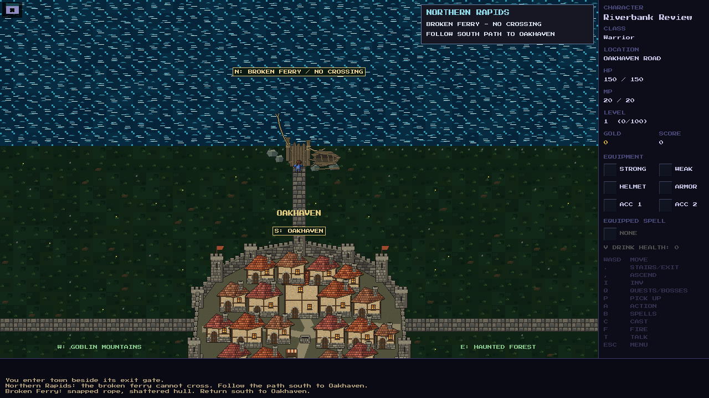

# Oakhaven north gate and broken ferry

The north gate leads out of Oakhaven to the **south bank of Northern Rapids**.
A short path reaches a ruined landing with two posts, a snapped ferry rope,
splintered planks and a stranded, broken boat. The river stays impassable
before and after the Lich King. Walk south to enter Oakhaven through its north
gate. The obsolete Elderwood / Castle Road sign has been removed; the existing
Northern Rapids sign remains beside the town gate.

## Implementation and scope

- `town_road_connection()` exposes a local northern visit in Oakhaven's existing
  safe exterior. It does not add a regional exit or connect to Elderwood.
- `generate_town_road()` leaves all northern river tiles blocked and puts the
  ferry inspection marker on dry land. Real movement enters and leaves town.
- `town_road_travel()` describes the wreck and rejects water entry. The ferry
  and return entrance have discovered minimap markers; dropped loot preserves
  the ferry marker.
- Existing Oakhaven interior/exterior saves refresh only the route's cells on
  load. Player position, exploration, dropped items and unrelated progress stay
  in place. Town maps are regenerated on town travel, rather than cached combat
  stages. No new persistent field or save format is introduced.
- The runtime art uses `tools/sprites/broken_ferry.py`, pixelkit grained timber,
  outlined layers and shore stones. `make sprites` includes its generator.
  `assets/images/broken-ferry.bmp` is a transparent 168×144 image anchored at
  `OAKHAVEN_FERRY_ART_X/Y`; the player can inspect the landing from dry land.
- Dawnmere and the other later regions have no gameplay changes in this step.
  Bram's dialogue, southbound departure art, keyed doors and inventory remain
  separate playtest follow-ups.

## Visual review

- [North gate and corrected sign](north-gate.png).
- [Departure view](departure.png), with the northward destination label kept
  on screen even when the river is above the camera.
- [Small 640×480 view](ferry-small.png), with readable destination and return
  labels.
- [Same-scale art comparison](native-comparison.png) beside the existing Inn
  and Oakhaven blacksmith.

Captures use the actual SDL game renderer. The final README atlas asset is
[`docs/world-map.png`](../world-map.png), with a northward path ending at a
broken ferry on the south bank. The river remains continuous; the Elderwood
road on the opposite bank remains disconnected. The README embed and
click-through both use that canonical file and its SHA-256 cache version.
The atlas was edited with the **built-in imagegen tool**, using the
[exact prompt](world-map-prompt.md). Later geography remains provisional.

## Validation

- Native game and test runner builds pass.
- **6,412 / 6,412 tests pass** in an isolated temporary save directory.
- Eight seeded route tests (8300–8307), alternating before/after the Lich,
  exercise the actual gate, ferry, save/load and town-return transitions.
  Real movement attempts from every accessible shoreline tile reject crossing;
  the entire northern river remains blocked. Loot and discovery survive saving.
- A separate SDL run completes **eight continuous round trips and 200 real
  movement actions**, including a saved shoreline return. Full and 640×480
  captures were inspected, along with the native art comparison and final atlas.
- Existing V2 maps with a closed north wall or absent return marker regain the
  route without moving the player or disturbing nearby loot and exploration.
- `git diff --check` passes. Changes are left uncommitted for manual review.
