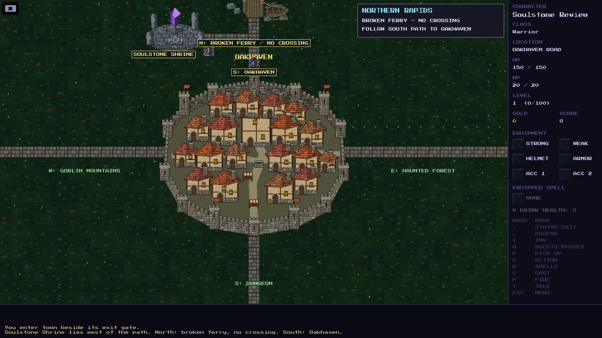
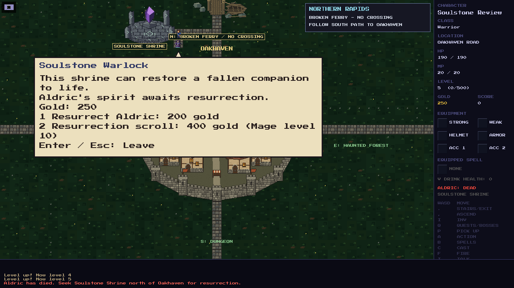
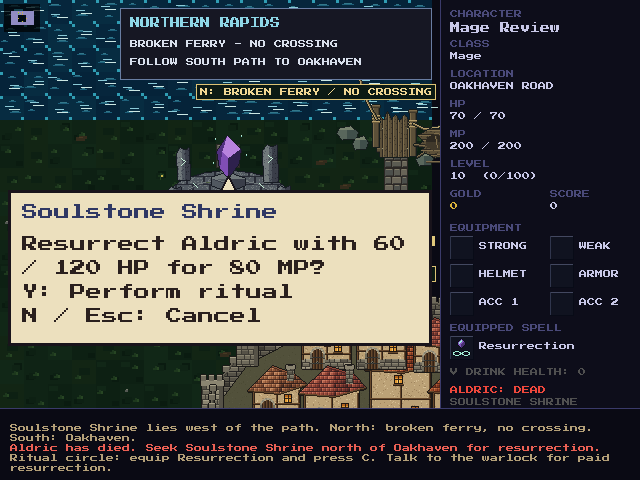

# Soulstone Shrine

Soulstone Shrine stands on dry ground beside Oakhaven's northern path, west
of the broken ferry and south of the impassable rapids. The shrine, its short
spur and its resident warlock are present from the start. Walk out of
Oakhaven's north gate and follow the path toward the ferry, then take the spur
west. The original ferry visit, return gate and other area exits remain usable.
The final [world map](../world-map.png) marks the same location.

The services unlock after recruiting a companion. Currently that companion is
Aldric; the unlock persists when he dies or waits at the Inn.
The warlock explains the shrine to a player who has not yet recruited anyone.

## Paid resurrection

Stand beside the warlock and use **Talk** (`T` by default). Choose **1**, then
confirm **Y** to resurrect Aldric for **200 gold**. He returns at full health on
free adjacent ground and rejoins the travelling party. **N / Esc / Enter**
cancels. Insufficient gold, no dead companion or blocked placement leave the
party and gold unchanged. Repeated confirmation cannot charge twice.

## Mage ritual

A **level-10 Mage** with a recruited companion can choose **2** at the warlock
to buy **Scroll: Resurrection** for **400 gold**. The scroll takes one ordinary
bag slot. Read it with the inventory's Use action, then equip Resurrection in
the spellbook. It has one rank; learning and casting both require Mage level
10. A full bag, insufficient funds or already knowing the spell prevents a
redundant purchase.

Walk onto the glowing diamond in the ritual circle and use **Cast** (`C` by
default). The status message names the character's remapped Cast key. Confirm
**Y** to spend **80 base MP**, with existing spell-cost reductions, and restore
Aldric at **60/120 HP**. Casting directly requires no warlock conversation or
aim direction. The confirmation names the target, HP and actual MP cost.

A successful Mage ritual consumes one player turn. Opening or canceling the
confirmation spends no MP or turn. Resurrection works only on this marked
position and requires no active enemies on the shrine map. Matching coordinates
in another region, standing beside the circle, insufficient MP, a living target
or occupied adjacent ground cannot perform a ritual or spend MP. The player
cannot use Resurrection to recover from game over.

## Companion death and saves

Aldric's lethal hit sets his HP to zero and his state to **dead**. He stops
following, fighting, blocking tiles and receiving hits. The sidebar displays
**ALDRIC: DEAD** and directs the player to Soulstone Shrine. His spirit remains
bound to the party across travel, Return to Town, cached adventures and saves.
No body retrieval or inventory item is required. Living companions retain their
existing town healing; death requires resurrection.

The old automatic Inn recovery is removed. A dead Aldric has no Inn NPC or
recruitment prompt. Town arrival, dismiss/rejoin actions and save/load cannot
resurrect him. The current implementation provides shared Aldric revival
placement for the paid and Mage routes. A later recruitable Mage and additional
companions remain future work.

Save version **234** stores the recruitment unlock and shrine confirmation state alongside existing
party HP/state, gold and spell data. The old recovery state becomes persistent
death. Saved Oakhaven exteriors gain only the shrine cells and spur; dropped
loot, exploration, wounds, gold and other routes are retained. A player standing
on a newly solid landmark is moved onto the ritual circle; affected loot moves
to nearby collectible ground. Exterior maps regenerate normally on travel and
are not cached stages. The shrine does not modify forest, mountain or dungeon
snapshots. Existing save inspection used an isolated copy; local saves were not
rewritten.

## Art and validation

- The native game builds and **6,609/6,609** gameplay assertions pass. The
  focused resurrection and companion run passes **151 assertions** under
  AddressSanitizer and UndefinedBehaviorSanitizer. New resurrection and
  companion code passes `-Wall -Wextra -Werror` syntax checks.
- `tools/sprites/soulstone_shrine.py` uses pixelkit layers, masonry, outlines,
  bevels and the established 24-pixel scale. It writes the transparent runtime
  sprite `assets/images/soulstone-shrine.bmp`.
- The warlock uses the existing native NPC renderer with a distinct hood,
  violet robes and turquoise trim. Resurrection has a soulstone-and-ring icon.
- Both the shrine and warlock have discovered minimap markers. The ritual
  remains visible and usable under dropped loot.
- Native SDL review covers arrival before recruitment, the warlock's menu,
  paid confirmation and revival, the direct Mage ritual, and 640×480 dialogs.
  The shrine was inspected beside Oakhaven and its broken ferry at their normal
  renderer scale. The shrine label is separated from the ferry label.
- Gameplay tests cover all three classes, eligibility, exact fees, cancellation,
  repeat input, scroll purchase and learning, spell restrictions, cost-reducing
  equipment, loot, blocked placement, save/load continuation and legacy recovery.
  Existing riverbank and exterior travel tests exercise real movement through
  the unchanged exits over multiple seeds.

The canonical world map was edited with built-in imagegen. Its final file
remains `docs/world-map.png`, and both README URLs use its checksum cache key.
The [exact prompt](world-map-prompt.md) records the edit and preservation rules.
The [river edit prompt](river-map-prompt.md) records its upstream extension:
snowmelt from Frostfell flows past Rosemoor and Blackwater Swamp into Northern
Rapids, then east through the estuary. Oakhaven's broken ferry remains impassable.
